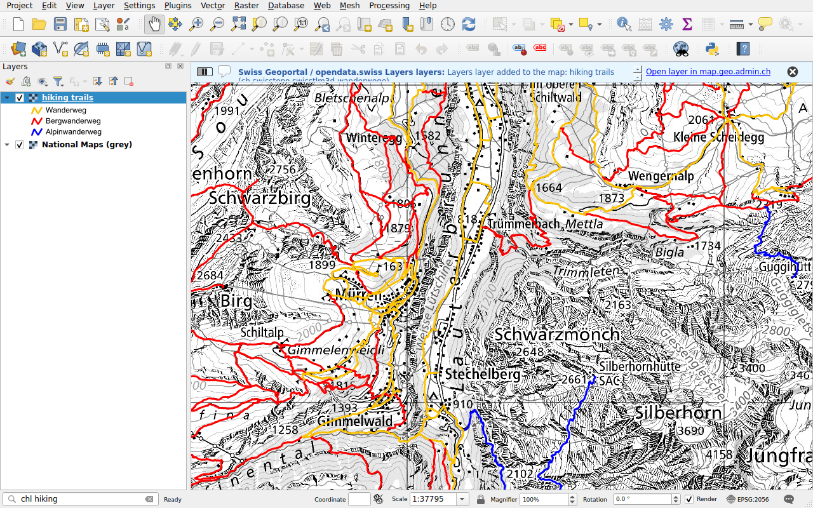

# Swiss Toolbox for QGIS: locator filters (location and layer search), STAC catalogs, Elevation profile and more

Swiss Locator brings the Swiss Geoportal into [QGIS](https://qgis.org/).
Type in the locator bar of QGIS, as you would on
[map.geo.admin.ch](https://map.geo.admin.ch/), and:

* [search for locations](https://opengisch.github.io/qgis-swiss-locator/en/search/locations/):
  cantons, municipalities, districts, ZIP codes, addresses, parcels and the
  names of the national map
* [search for features](https://opengisch.github.io/qgis-swiss-locator/en/search/features/)
  of the layers of the geoportal
* [add layers](https://opengisch.github.io/qgis-swiss-locator/en/layers/) of
  the federal geoportal and of opendata.swiss, as WMS, WMTS or vector tiles
* [download data](https://opengisch.github.io/qgis-swiss-locator/en/downloads/swisstopo/)
  from the STAC catalogs of swisstopo, viageo.ch and Basel-Stadt

It also draws the terrain of swissALTI3D in the
[elevation profiles](https://opengisch.github.io/qgis-swiss-locator/en/elevation-profile/)
of QGIS, and [geocodes](https://opengisch.github.io/qgis-swiss-locator/en/geocoding/)
tables of addresses with Processing.



## Documentation

**https://opengisch.github.io/qgis-swiss-locator/**, in
[English](https://opengisch.github.io/qgis-swiss-locator/en/),
[French](https://opengisch.github.io/qgis-swiss-locator/fr/),
[German](https://opengisch.github.io/qgis-swiss-locator/de/) and
[Italian](https://opengisch.github.io/qgis-swiss-locator/it/).

## Data files

Some searches rely on data files generated weekly by the
[Update data](.github/workflows/update-data.yml) workflow and published on
[GitHub Pages](https://opengisch.github.io/qgis-swiss-locator/data/v1/index.json):
* the searchable layers of map.geo.admin.ch (feature search)
* the layers of the WMS services referenced by opendata.swiss (layer search,
  e.g. by layer name such as `zg_naturschutz`)

The plugin updates its cache from there at most once a day, in the background,
and falls back on the copy bundled in each release when GitHub is unreachable.
A WMS service offline during the weekly run keeps its published layers for up
to 30 days.
See [swiss_locator/remote_data](swiss_locator/remote_data).

When running the plugin from the sources (e.g. symlinked in the QGIS plugins
folder), put the files in `swiss_locator/remote_data/bundled/` (git-ignored),
then reload the plugin. The plugin uses them as long as they are fresher than
its cache:

```sh
# generate them locally, no need of GitHub Pages
python -m scripts build [--only opendata_swiss_wms_layers.json]
# or download the published ones
python -m scripts fetch
```

`python -m scripts build --site _site` generates the GitHub Pages site as CI does.

## Building the documentation

The documentation is in [docs](docs), one folder per language, built with
[Zensical](https://zensical.org) and published on GitHub Pages by the
[Documentation](.github/workflows/docs.yml) workflow:

```sh
pip install -r docs/requirements.txt
python docs/build.py
```

The screenshots are taken by a script driving QGIS in Docker:
`docs/screenshots/run.sh`. See [the skill](.claude/skills/docs/SKILL.md) for
the details.

## Who

This plugin has been developed by OPENGIS.ch with friendly support from
the [Swiss QGIS User Group](https://qgis.ch).
