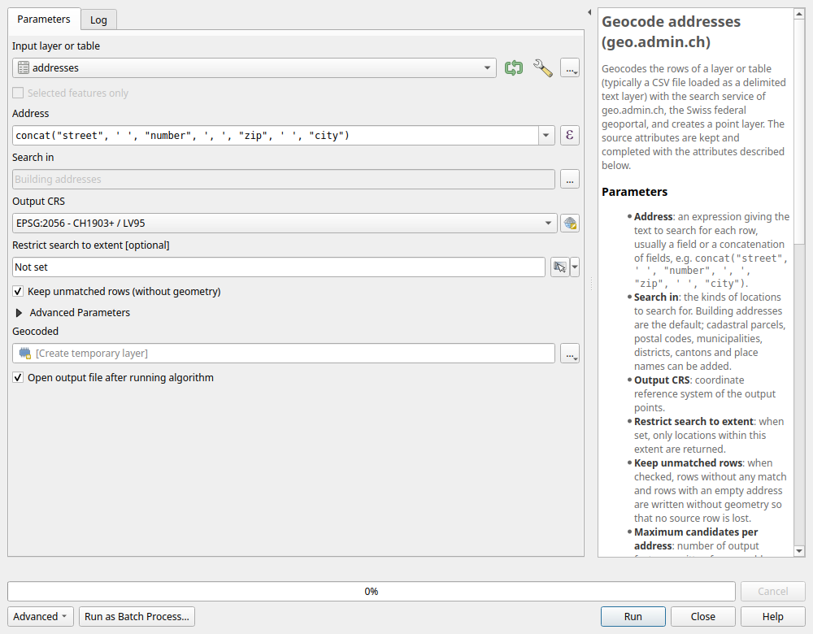

# QGIS Swiss Locator plugin

## What 
Integrates the Swiss Geoportal into QGIS

Similarly to the online geoportal [https://map.geo.admin.ch](https://map.geo.admin.ch/), this plugin allows to search within [QGIS](https://qgis.org/) desktop for

* Locations:
   * Cantons, cities and municipalities,
   * Place names as printed on the national map (SwissNames)
   * Districts
   * ZIP codes
   * Addresses
   * Cadastral parcels
* Layers from the Federal Geoportal (map.geo.admin.ch) or opendata.swiss, which can easily be added to the map
   * WMS
   * WMTS
   * Vector Tiles
* Features (search through features descriptions)
* Downloadable files from the Swisstopo STAC catalog

Elevation profiles can be displayed in QGIS and included in layouts. These profiles use the Elevation Profile service (swissALTI3D height model).

Tables of addresses (for instance a CSV file) can be geocoded in bulk into a point layer with the **Geocode addresses** Processing algorithm, see [Batch geocoding](#batch-geocoding).

## How

Type the text to search in the locator bar of QGIS, and double-click a result.

The **[documentation](https://opengisch.github.io/qgis-swiss-locator/)**, in
English, French, German and Italian, shows each search with examples.


### Batch geocoding

The plugin adds a **Swiss Locator** provider to the Processing toolbox with the algorithm
**Geocode addresses (geo.admin.ch)**. It geocodes every row of a layer or table and writes a point
layer that keeps the source attributes.

1. Load the table of addresses, e.g. a CSV file through Layer -> Add Layer -> Add Delimited Text Layer
   with the geometry definition set to *No geometry*.
2. Open the Processing toolbox and run Swiss Locator -> Geocode addresses (geo.admin.ch).
3. Set the **Address** expression: either the column holding the full address, or a concatenation of
   columns such as `concat("street", ' ', "number", ', ', "zip", ' ', "city")`.
4. Optionally restrict the search to an extent, choose the output CRS (LV95 by default) or search
   other kinds of locations than building addresses (parcels, postal codes, municipalities...).



Each output feature gets the following attributes in addition to the source columns:

* `geocode_status`: `matched`, `unmatched`, `empty` (no address in the row) or `error` (the request
  failed, the reason is given in `geocode_message`). Unmatched and empty rows are kept without
  geometry unless *Keep unmatched rows* is unchecked.
* `geocode_quality`: `exact` when every word of the address is found in the result, `fuzzy`
  otherwise. The search service is fuzzy and almost always returns a location, even for typos or
  unknown addresses, so check this attribute before trusting a result.
* `geocode_candidates`: number of locations returned by the service. More than one means the
  address is ambiguous; the *Maximum candidates per address* parameter writes several of them, best
  first, with their rank in `geocode_candidate`.
* `geocode_label`, `geocode_detail`, `geocode_origin`, `geocode_feature_id` (EGID and EDID of the
  building), `geocode_rank` and `geocode_weight` as returned by the service.

The algorithm is also available from the model designer, the batch interface and `qgis_process`.

The geo.admin.ch services are free of charge but subject to a
[fair use policy](https://www.geo.admin.ch/en/general-terms-of-use-fsdi) of about 20 requests per
minute on average. Identical addresses are requested only once and a configurable pause is applied
between requests. Keep it for large tables and do not run unattended bulk jobs.

## Data files

Some searches rely on data files generated weekly by the
[Update data](.github/workflows/update-data.yml) workflow and published on
[GitHub Pages](https://opengisch.github.io/qgis-swiss-locator/data/v1/index.json):
* the searchable layers of map.geo.admin.ch (feature search)
* the layers of the WMS services referenced by opendata.swiss (layer search,
  e.g. by layer name such as `zg_naturschutz`)

The plugin updates its cache from there at most once a day, in the background,
and falls back on the copy bundled in each release when GitHub is unreachable.
A WMS service offline during the weekly run keeps its published layers for up
to 30 days.
See [swiss_locator/remote_data](swiss_locator/remote_data).

When running the plugin from the sources (e.g. symlinked in the QGIS plugins
folder), put the files in `swiss_locator/remote_data/bundled/` (git-ignored),
then reload the plugin. The plugin uses them as long as they are fresher than
its cache:

```sh
# generate them locally, no need of GitHub Pages
python -m scripts build [--only opendata_swiss_wms_layers.json]
# or download the published ones
python -m scripts fetch
```

`python -m scripts build --site _site` generates the GitHub Pages site as CI does.

## Documentation

The documentation is in [docs](docs), one folder per language, built with
[Zensical](https://zensical.org) and published on GitHub Pages by the
[Documentation](.github/workflows/docs.yml) workflow:

```sh
pip install -r docs/requirements.txt
python docs/build.py
```

The screenshots are taken by a script driving QGIS in Docker:
`docs/screenshots/run.sh`. See [the skill](.claude/skills/docs/SKILL.md) for
the details.

## Who

This plugin has been developed by OPENGIS.ch with friendly support from
the [Swiss QGIS User Group](https://qgis.ch).
