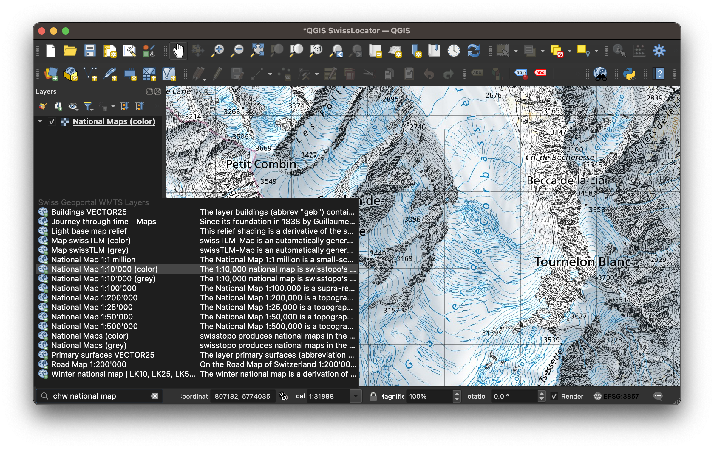
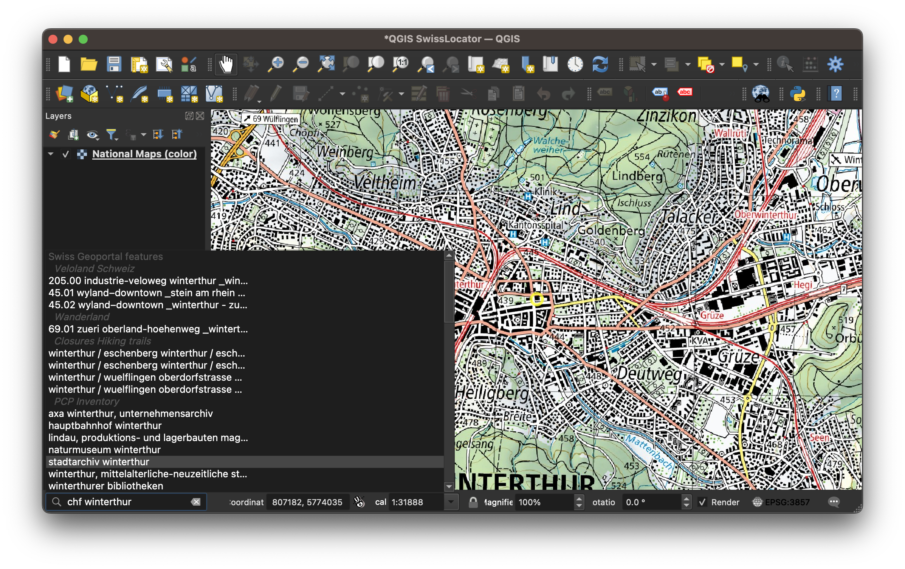
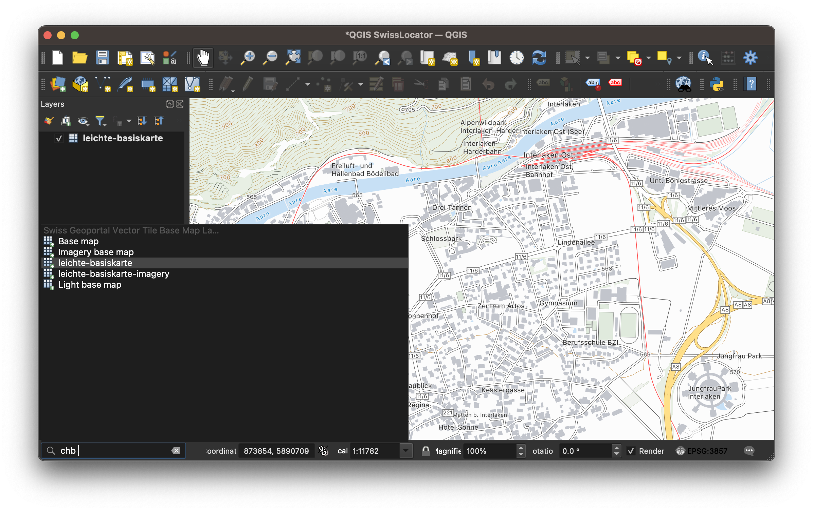
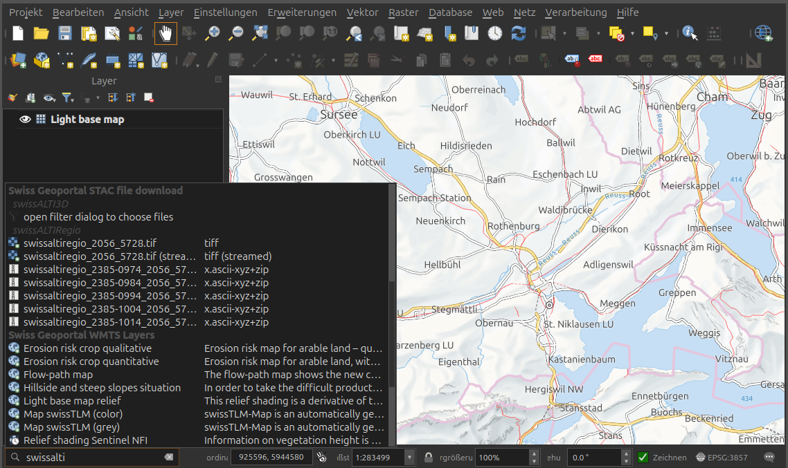
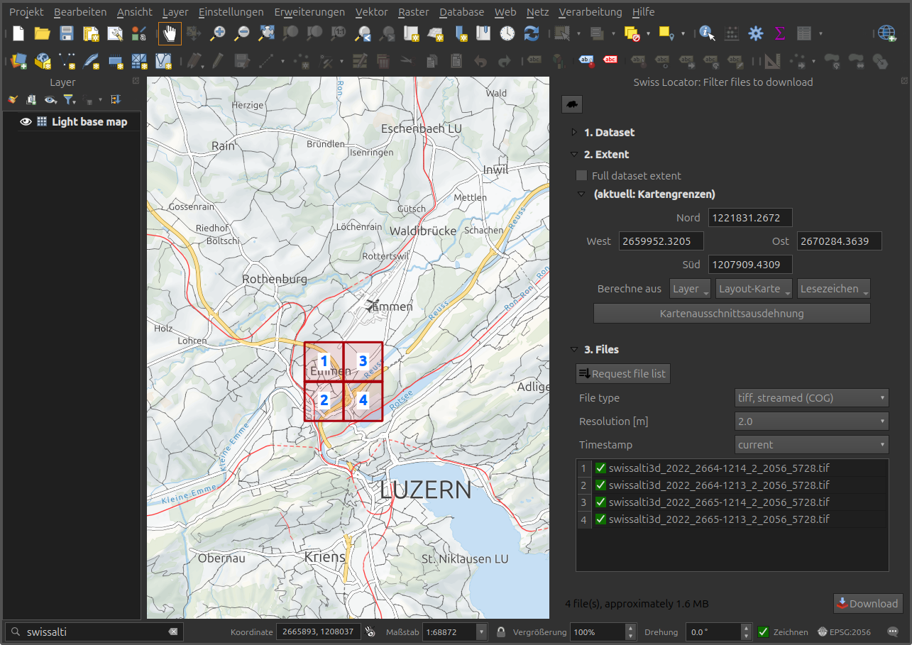

# QGIS Swiss Locator plugin

## What 
Integrates the Swiss Geoportal into QGIS

Similarly to the online geoportal [https://map.geo.admin.ch](https://map.geo.admin.ch/), this plugin allows to search within [QGIS](https://qgis.org/) desktop for

* Locations:
   * Cantons, cities and municipalities,
   * Place names as printed on the national map (SwissNames)
   * Districts
   * ZIP codes
   * Addresses
   * Cadastral parcels
* Layers from the Federal Geoportal (map.geo.admin.ch) or opendata.swiss, which can easily be added to the map
   * WMS
   * WMTS
   * Vector Tiles
* Features (search through features descriptions)
* Downloadable files from the Swisstopo STAC catalog

Elevation profiles can be displayed in QGIS and included in layouts. These profiles use the Elevation Profile service (swissALTI3D height model).

## How

Type the text to search in the locator bar.

If the result is a **WMTS layer**, double-clicking on it will try to add it to the map. 
It might not be possible since some layers are only visible in the geoportal (map.geo.admin.ch).
In this case, a link will be shown to display the layer in the geoportal.



If the result is a **location** or **feature**, 
double-clicking on it will move the map canvas to the result and highlight its position.
If any further information can be shown, an info window will be shown over the map.



If the result is a **vector tiles layer**,
double clicking it will add it to the map canvas as another background layer.



If the result is a **file download** from the Swiss Geoportal STAC catalog,
double clicking it will download the file and add it to the map.



For topics with many files associated,
double clicking opens a filter dialog to further narrow down the search.
Users can do a spatial search, as well as filter file type, timestamp, raster
resolution, and more.


For displaying **elevation profiles**:
 1. Go to View -> Elevation Profiles -> New Elevation Profile.
2. Draw a line on the map using the `Capture Curve` tool from the Elevation Profile widget.
3. Optionally, you can change both the profile visibility and the rendering order in the Elevation Profile's Layer Tree.


## More

The search is performed through the QGIS [locator bar](https://qgis.org/en/site/forusers/visualchangelog30/#feature-locator-bar).

Configuration is achieved in the main application settings under the `locator` tab. You will be able to:
* Enable or disable searches (locations, layers, features)
* Customize prefixes, define if they are default filters (used without prefix)
* Access to the configuration of the plugin
* Include or exclude opendata.swiss data from layer searches

In the configuration of the plugin, further customization can be achieved:
* Language definition (English, German, French, Italian, Rumantsch)
* CRS definition (project, CH1903 or CH1903+)
* Defining if the plugin will try to display further information in a tool tip
* Defining layers used in the feature search

## Data files

Some searches rely on data files generated nightly by the
[Update data](.github/workflows/update-data.yml) workflow and published on
[GitHub Pages](https://opengisch.github.io/qgis-swiss-locator/data/v1/index.json):
* the searchable layers of map.geo.admin.ch (feature search)
* the layers of the WMS services referenced by opendata.swiss (layer search,
  e.g. by layer name such as `zg_naturschutz`)

The plugin updates its cache from there at most once a day, in the background,
and falls back on the copy bundled in each release when GitHub is unreachable.
A WMS service that cannot be reached keeps its published layers for up to 30
days.
See [swiss_locator/remote_data](swiss_locator/remote_data).

When running the plugin from the sources (e.g. symlinked in the QGIS plugins
folder), put the files in `swiss_locator/remote_data/bundled/` (git-ignored),
then reload the plugin. The plugin uses them as long as they are fresher than
its cache:

```sh
# generate them locally, no need of GitHub Pages
python -m scripts build [--only opendata_swiss_wms_layers.json]
# or download the published ones
python -m scripts fetch
```

`python -m scripts build --site _site` generates the GitHub Pages site as CI does.

## Who

This plugin has been developed by OPENGIS.ch with friendly support from
the [Swiss QGIS User Group](https://qgis.ch).
