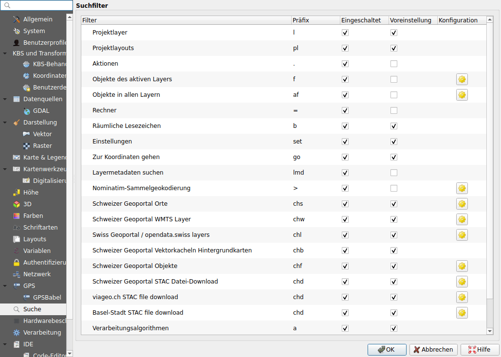
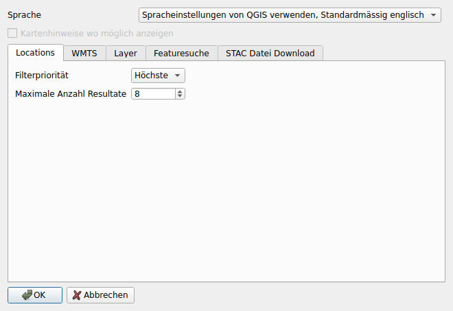
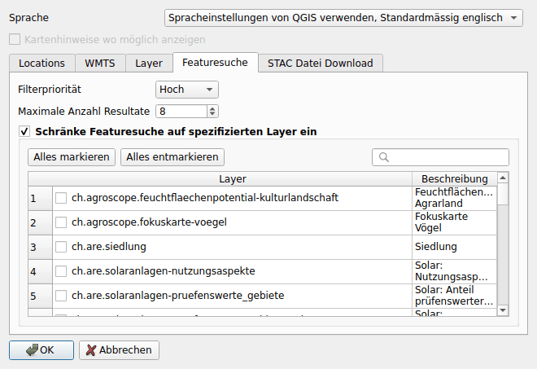

# Konfiguration

## In den Optionen von QGIS {#in-the-options-of-qgis}

Öffnen Sie **Einstellungen ▸ Optionen ▸ Suche**. Jede Suche des Plugins ist
dort mit ihrem Präfix aufgeführt:

- **Eingeschaltet**: deaktivieren, um die Suche auszuschalten;
- **Voreinstellung**: wenn aktiviert, läuft die Suche ohne ihr Präfix;
- **Präfix**: lässt sich ändern;
- die Schaltfläche rechts öffnet die Konfiguration des Plugins (die Basiskarten
  haben keine).

Das Herunterladen von Daten hat eine Suche pro Katalog, mit demselben Präfix:
**Schweizer Geoportal STAC Datei-Download**,
**viageo.ch STAC file download** und **Basel-Stadt STAC file download**.

## Im Plugin

Die Konfiguration des Plugins öffnet sich über die Schaltfläche einer Suche in
den obigen Optionen.

**Sprache**
:   Die Sprache der Resultate. Standardmässig jene von QGIS, sofern das
    Geoportal sie anbietet, sonst Englisch.

**Kartenhinweise wo möglich anzeigen**
:   Zeigt die Informationen von map.geo.admin.ch zu einem Ort oder einem Objekt
    in einer Sprechblase über der Karte an. Dafür ist die Bibliothek QtWebKit
    nötig, die QGIS 4 nicht enthält: Die Option ist dann ausgegraut.

Jede Suche, ausser den Basiskarten, hat ihren eigenen Reiter:

**Filterpriorität**
:   Die Reihenfolge, in der die Resultate der Suchen in der Suchleiste
    erscheinen.

**Maximale Anzahl Resultate**
:   Wie viele Resultate die Suche auflistet.

**Daten von opendata.swiss berücksichtigen** (WMS-Layer)
:   Auch die Layer der auf opendata.swiss referenzierten Dienste durchsuchen.

**Max. Anzahl von Dateien pro Ergebnis** (Daten herunterladen)
:   Ein Datensatz mit mehr Dateien öffnet das Filterfenster, statt sie
    aufzulisten.

| Suche | Priorität | Resultate |
|-------|-----------|-----------|
| Orte | Höchste | 8 |
| WMS-Layer | Hoch | 5 |
| WMTS-Layer | Mittel | 8 |
| Objekte | Hoch | 8 |
| Daten herunterladen | Tief | 5 pro Katalog, und 5 Dateien pro Resultat |

### Objektsuche {#feature-search}

Standardmässig durchsucht die Objektsuche alle Layer des Geoportals, deren
Objekte durchsuchbar sind. Aktivieren Sie
**Schränke Featuresuche auf spezifizierten Layer ein** und wählen Sie die zu
durchsuchenden Layer aus: Das Suchfeld filtert die Liste.

