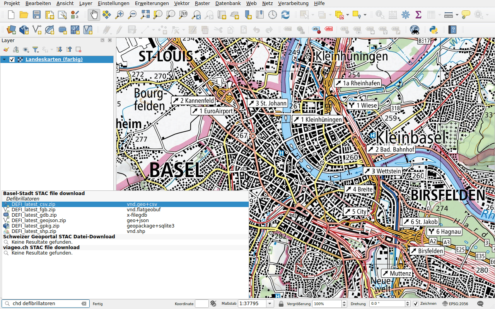

# Daten von Basel-Stadt

Präfix: `chd`

Der Kanton Basel-Stadt veröffentlicht seine Geodaten auf
[geo.bs.ch](https://www.geo.bs.ch): Zonenpläne, amtliche Vermessung,
Velorouten, Defibrillatoren und mehr. Jeder Datensatz liegt in mehreren
Formaten vor, alle aufgelistet: GeoPackage, GeoJSON, FlatGeobuf, Shapefile,
FileGDB, CSV und für manche DXF und DWG. Geben Sie zum Beispiel
`chd defibrillatoren` ein.

Doppelklicken Sie auf ein Format und wählen Sie einen Ordner: Die Datei, ein
Archiv (ZIP), wird heruntergeladen und der enthaltene Datensatz zur Karte
hinzugefügt. DWG- und INTERLIS-Dateien kann QGIS nicht immer lesen: Das Archiv
wird dann nur heruntergeladen.
