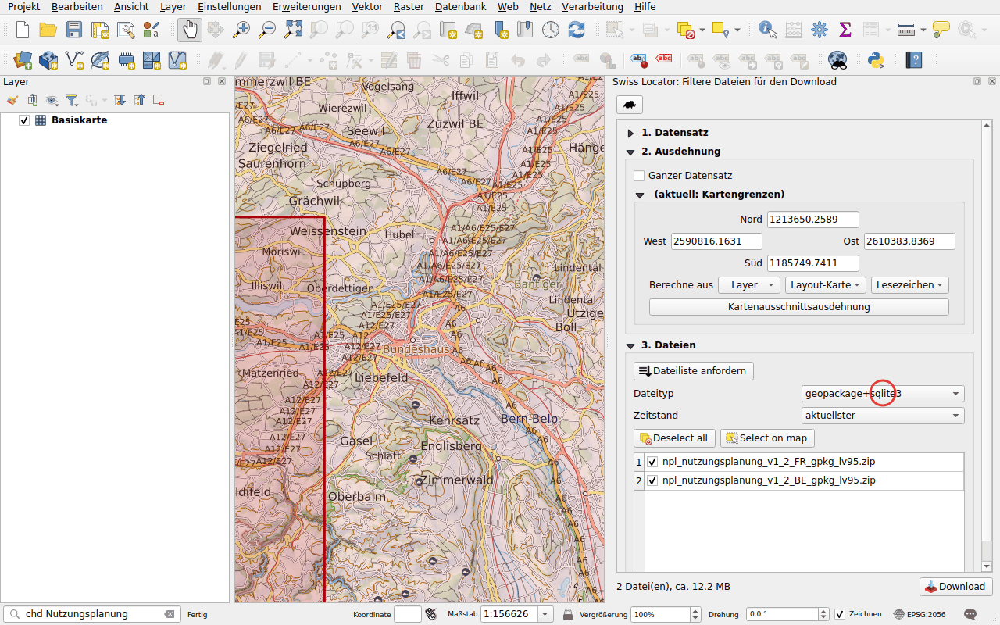

# Daten der Kantone (geodienste.ch)

Präfix: `chd`

[geodienste.ch](https://geodienste.ch) veröffentlicht die Geodaten der Kantone
in den Datenmodellen des Bundes, für jeden Kanton dieselben: amtliche
Vermessung, Nutzungsplanung, Gefahrenkarten, Richtpläne, Kataster der
belasteten Standorte, Wildruhezonen und rund dreissig weitere. Die Titel sind
deutsch, französisch oder italienisch, in der Sprache des Plugins, sonst
deutsch: Geben Sie zum Beispiel `chd Nutzungsplanung` ein.

Die Suche läuft standardmässig: Deaktivieren Sie geodienste.ch unter den
[lokalen Katalogen](../configuration.md#in-the-plugin), um sie auszuschliessen.

Ein Datensatz hat eine Datei pro Kanton und Format: Sein Resultat öffnet das
[Filterfenster](swisstopo.md#a-dataset-with-many-files), das die Kantone der
Ausdehnung auflistet. Der Umriss einer Datei ist das Rechteck um ihren Kanton.
Nicht jeder Kanton veröffentlicht jeden Datensatz, und manche geben ihre nur mit
einem Login auf geodienste.ch ab, etwa die amtliche Vermessung von Luzern oder
der Waadt: Ihr Download schlägt fehl.

Wählen Sie das Format unter **Dateityp**:

- GeoPackage, Shapefile und CSV: Das Archiv (ZIP) wird heruntergeladen und die
  enthaltenen Datensätze werden zur Karte hinzugefügt; ein CSV ist eine Tabelle
  ohne Geometrie. Tabellen und Attribute sind in der Sprache des Katalogs
  benannt.
- INTERLIS: Das Archiv enthält den Transfer und sein Modell und wird nur
  heruntergeladen; öffnen Sie es mit einem Plugin wie
  [Model Baker](https://opengisch.github.io/QgisModelBaker/). Die
  Transferdateien sind ebenfalls aufgelistet, für die amtliche Vermessung eine
  pro Gemeinde.

Die amtliche Vermessung eines grossen Kantons ist Hunderte von Megabyte gross,
als INTERLIS über ein Gigabyte: Für eine Gemeinde nehmen Sie ihre
Transferdatei.
