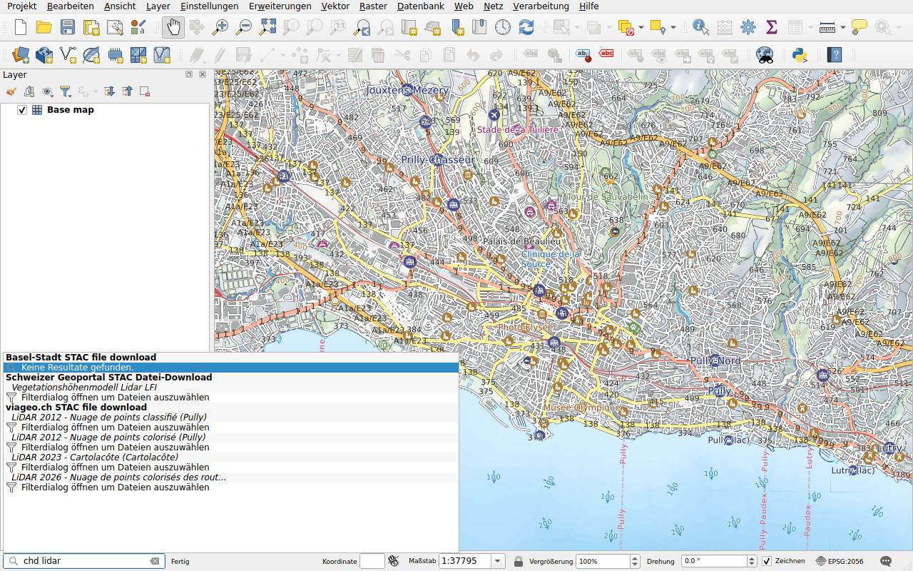

# Kantonale und kommunale Daten (viageo.ch)

Präfix: `chd`

[viageo.ch](https://viageo.ch) veröffentlicht die Daten des Kantons Waadt und
seiner Gemeinden: die Bathymetrie der Seen, Luftbilder mit 2 cm Auflösung und
LiDAR-Punktwolken. Die Titel sind französisch: Geben Sie `lidar`, `orthophoto`
oder `bathymétrie` ein, mit den Akzenten.

Die Resultate funktionieren [wie die des Geoportals](swisstopo.md): Ein Luftbild
oder eine Bathymetrie ist eine einzelne Datei, zum Herunterladen oder
*gestreamt*; eine Punktwolke öffnet das Filterfenster. Manche Dateien sind
gross, etwa das Luftbild von Pully vom Juni 2026 mit 35 GB: Fügen Sie es
*gestreamt* hinzu.
