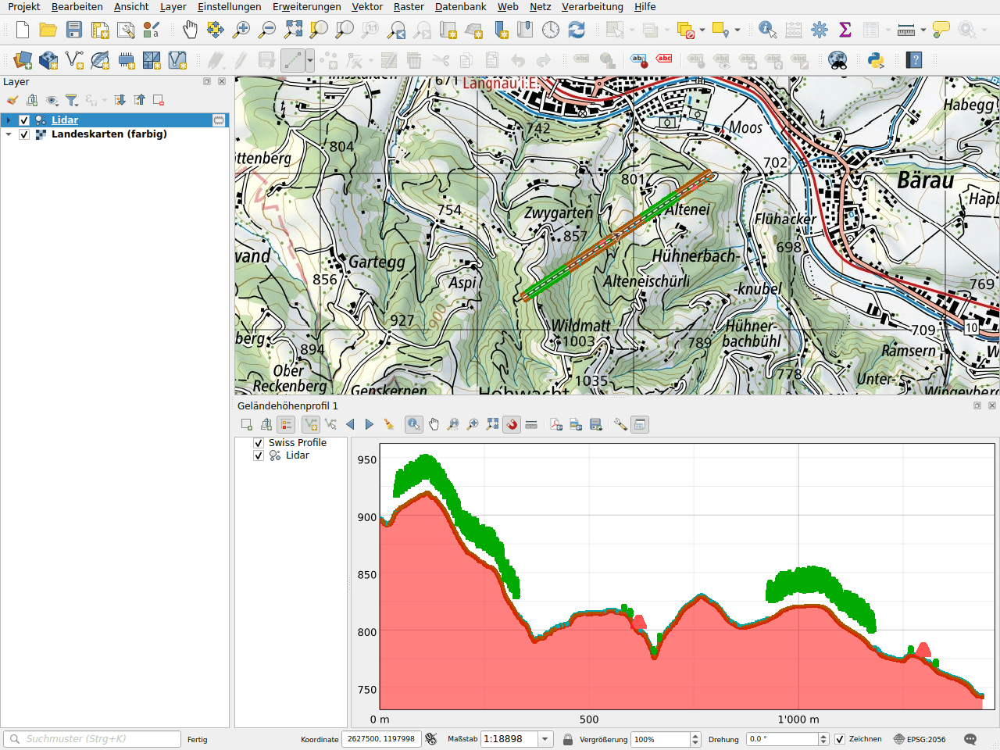

# Höhenprofil

Das Plugin ergänzt die Geländehöhenprofile von QGIS um das Gelände von
swisstopo. Die Höhen stammen vom Profildienst des Geoportals, der das
Höhenmodell swissALTI3D verwendet. Es muss kein Layer geladen werden: Das
Profil wird für die von Ihnen gezeichnete Linie online berechnet.

## Ein Profil zeichnen

1. Öffnen Sie **Ansicht ▸ Geländehöhenprofile ▸ Neues Geländehöhenprofil**.
2. Klicken Sie in der Werkzeugleiste des Profils auf **Kurve aufnehmen** und
   zeichnen Sie dann die Linie auf der Karte: ein Klick pro Stützpunkt, ein
   Rechtsklick zum Abschliessen.
3. Das Gelände von swisstopo wird als **Swiss Profile** in Rot gezeichnet.

## Beispiel: mit einer Lidar-Punktwolke

Das Profil zeigt die Layer des Projekts zusammen mit dem Gelände. Hier eine
Punktwolke entlang einer 1,4 km langen Linie in den Hügeln von Langnau im
Emmental: Der Boden, die Bäume und die Dächer zweier Bauernhäuser stehen auf
dem Gelände von swissALTI3D.

!!! note
    Die Punktwolke dieses Beispiels wurde für die Dokumentation künstlich
    erzeugt. Echte Punktwolken wie swissSURFACE3D lassen sich mit der Suche
    [Daten herunterladen](downloads/index.md) beziehen.

Deaktivieren Sie im Layerbaum des Profils **Swiss Profile**, um das Gelände
auszublenden, oder verschieben Sie es, um die Zeichenreihenfolge zu ändern.

## In einem Drucklayout

Wie die anderen Layer eines Profils lässt sich das Swiss Profile im Element
**Geländehöhenprofil** eines Drucklayouts anzeigen.
