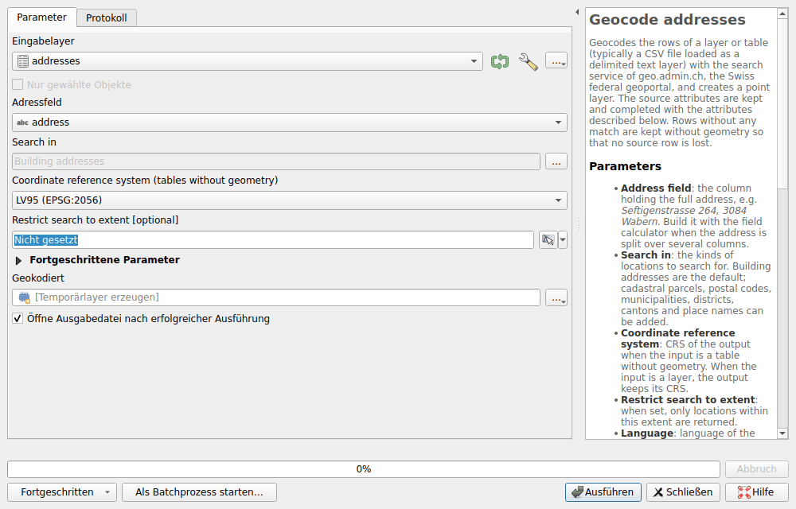
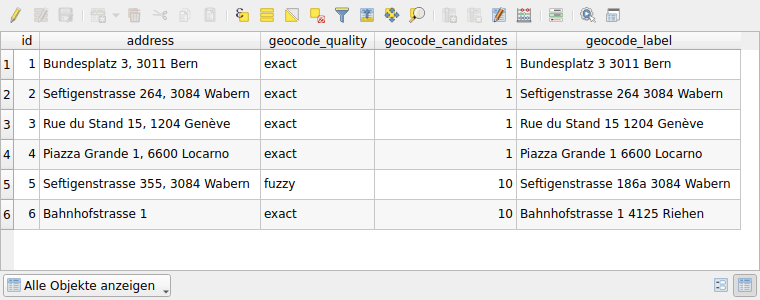

# Geokodierung

Machen Sie aus einer Adresstabelle, etwa einer CSV-Datei, einen Punktlayer. Der
Verarbeitungsalgorithmus **Geocode addresses** sucht jede Adresse mit der Suche
des Geoportals, derjenigen der [Ortssuche](search/locations.md), und behält die
Spalten der Tabelle.

## Eine Tabelle geokodieren

1. Laden Sie die Tabelle. Für eine CSV-Datei: **Layer ▸ Layer hinzufügen ▸
   Getrennte Textdatei als Layer hinzufügen…**, mit **Keine Geometrie (nur
   Attributtabelle)** als **Geometriedefinition**.
2. Öffnen Sie **Verarbeitung ▸ Werkzeugkiste**, dann **Swiss Locator ▸
   Geocoding ▸ Geocode addresses**.
3. Wählen Sie die Tabelle als **Eingabelayer** und die Spalte mit der ganzen
   Adresse als **Adressfeld**, zum Beispiel `Seftigenstrasse 264, 3084 Wabern`.
4. Klicken Sie auf **Ausführen**. Die Punkte werden der Karte als
   **Geokodiert** hinzugefügt.



Ist die Adresse auf mehrere Spalten verteilt, fügen Sie diese zuerst mit dem
**Feldrechner** zusammen, zum Beispiel
`concat("strasse", ' ', "nummer", ', ', "plz", ' ', "ort")`.

Die weiteren Parameter:

- **Search in**: standardmässig die Gebäudeadressen. Parzellen,
  Postleitzahlen, Gemeinden, Bezirke, Kantone und die Namen der Landeskarte
  können hinzugefügt werden.
- **Coordinate reference system (tables without geometry)**: LV95 oder LV03.
  Ein Layer mit Geometrie behält seines.
- **Restrict search to extent**: Nur die Orte innerhalb dieser Ausdehnung
  werden gefunden.
- Unter **Fortgeschrittene Parameter** die Sprache der Bezeichnungen,
  **Language**, und die Pause zwischen zwei Anfragen, **Pause between requests
  (milliseconds)**: siehe [faire Nutzung](#fair-use).

## Das Ergebnis

Jede Zeile ergibt einen Punkt, mit den Spalten der Tabelle und diesen
Attributen:

| Attribut | Inhalt |
|----------|--------|
| `geocode_quality` | `exact`, wenn jedes Wort der Adresse im gefundenen Ort vorkommt, sonst `fuzzy` |
| `geocode_candidates` | Die Anzahl gefundener Orte, bis 10. Mehr als einer bedeutet, dass die Adresse mehrdeutig ist: Der beste wird behalten. |
| `geocode_label` | Der gefundene Ort |
| `geocode_detail`, `geocode_origin`, `geocode_feature_id`, `geocode_rank`, `geocode_weight` | Der Ort, wie ihn der Dienst liefert. Bei einer Adresse enthält die Objekt-ID den EGID und den EDID des eidgenössischen Gebäude- und Wohnungsregisters. |

Eine Zeile, für die kein Ort gefunden wurde oder deren Anfrage fehlschlug,
bleibt ohne Geometrie erhalten: Es geht keine Zeile verloren. Das Protokoll
des Algorithmus listet sie auf.



!!! warning
    Die Suche ist unscharf: Sie findet fast immer einen Ort, auch bei einem
    Tippfehler oder einer Adresse, die es nicht gibt. Prüfen Sie
    `geocode_quality`, bevor Sie einem Punkt vertrauen. Oben gibt es keine
    Seftigenstrasse 355 in Wabern: Die Nummer 186a wird gefunden und als
    `fuzzy` bewertet. `Bahnhofstrasse 1` ist `exact`, hat aber 10 Kandidaten:
    Ohne Postleitzahl oder Ort kann jeder davon gemeint sein.

Für die Bewertung `exact` muss eine Zahl der Adresse, etwa die Hausnummer oder
die Postleitzahl, in `geocode_label` stehen. Ein Wort, etwa die Gemeinde oder
der Kanton, darf auch in `geocode_detail` stehen.

Der Dienst sucht höchstens zehn Wörter: Von einer längeren Adresse werden nur
die ersten zehn Wörter gesendet.

## Faire Nutzung {#fair-use}

Die Dienste von geo.admin.ch sind kostenlos, im Rahmen einer
[Fair-Use-Regelung](https://www.geo.admin.ch/de/allgemeine-nutzungsbedingungen-bgdi)
von etwa 20 Anfragen pro Minute. Der Algorithmus pausiert deshalb 3 Sekunden
zwischen zwei Anfragen: Tausend Adressen dauern etwa 50 Minuten. Gleiche
Adressen werden nur einmal angefragt.

Eine Anfrage, die wegen des Netzwerks oder eines überlasteten Dienstes
fehlschlägt, wird bis zu dreimal wiederholt. Nach fünf solchen Fehlern in
Folge bricht der Algorithmus ab: Der Dienst ist dann sehr wahrscheinlich nicht
verfügbar.

Für grössere Tabellen schreiben Sie zuerst an
[info@geo.admin.ch](mailto:info@geo.admin.ch), wie es die
Nutzungsbedingungen verlangen, oder verwenden Sie das amtliche
Gebäudeadressverzeichnis von swisstopo, einen Datensatz des
[Datenkatalogs](downloads/index.md).

## In Modellen und Skripten

Der Algorithmus funktioniert auch im Modellentwurf, in der
Stapelverarbeitung und mit Python:

```python
processing.run(
    "swiss_locator:geocodeaddresses",
    {"INPUT": layer, "FIELD": "address", "OUTPUT": "TEMPORARY_OUTPUT"},
)
```
