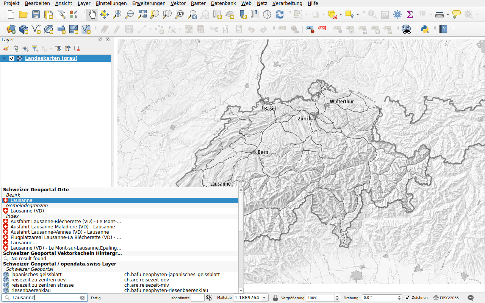
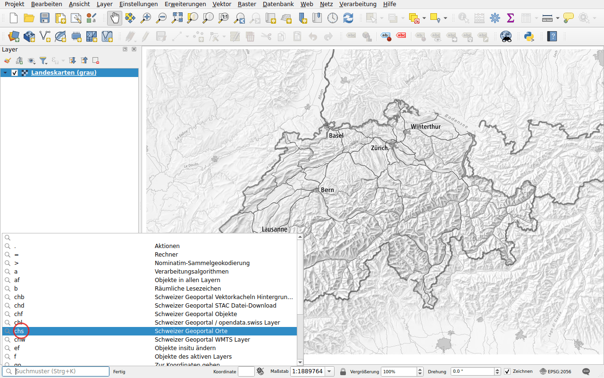

# Erste Schritte

## Installation

Öffnen Sie in QGIS **Erweiterungen ▸ Erweiterungen verwalten und installieren…**,
suchen Sie nach *Swiss Locator* und klicken Sie auf **Erweiterung installieren**.
Das Plugin benötigt QGIS 3.44 oder neuer, QGIS 4 inbegriffen.

## Suchen

Die Suchleiste befindet sich unten links im QGIS-Fenster, ihr Feld zeigt
*Suchmuster (Strg+K)*. Klicken Sie hinein oder drücken Sie ++ctrl+k++ und geben
Sie mindestens zwei Zeichen ein. Die Resultate erscheinen nach Art gruppiert,
sobald die Dienste antworten.

Doppelklicken Sie auf ein Resultat oder wählen Sie es mit den Pfeiltasten aus
und drücken Sie ++enter++:

- ein Ort oder ein Objekt: Die Karte springt dorthin und hebt es hervor;
- ein Layer oder eine Basiskarte: wird zur Karte hinzugefügt;
- eine Datei: wird heruntergeladen und zur Karte hinzugefügt.

## Die Suche mit einem Präfix eingrenzen

Ohne Präfix laufen alle Suchen des Plugins, dazu jene von QGIS. Beginnen Sie
mit einem Präfix und einem Leerzeichen, um nur eine davon auszuführen:

| Präfix | Suche |
|--------|-------|
| `chs` | [Orte](search/locations.md) |
| `chl` | [WMS-Layer](layers/wms.md), aus dem Geoportal und von opendata.swiss |
| `chw` | [WMTS-Layer](layers/wmts.md) |
| `chb` | [Basiskarten](layers/base-maps.md), als Vektorkacheln |
| `chf` | [Objekte](search/features.md) |
| `chd` | [Daten herunterladen](downloads.md) |

Beispielsweise sucht `chs Lausanne` nur nach Orten namens Lausanne.

Sie müssen sie nicht kennen: Klicken Sie in die Suchleiste, ohne etwas
einzugeben, sie listet alle Suchen mit ihrem Präfix auf. Doppelklicken Sie auf
eine: Ihr Präfix wird für Sie eingegeben.

Die Präfixe sowie die Auswahl der Suchen, die ohne Präfix laufen, lassen sich
in den [Optionen von QGIS](configuration.md#in-the-options-of-qgis) ändern.

## Sprache

Die Resultate erscheinen in der Sprache von QGIS, sofern das Geoportal sie
anbietet: Deutsch, Englisch, Französisch, Italienisch oder Rätoromanisch.
Andernfalls auf Englisch. Die Sprache lässt sich in der
[Konfiguration](configuration.md) des Plugins einstellen.

## Koordinatenbezugssystem

Die Karte kann ein beliebiges Koordinatenbezugssystem verwenden. Das Plugin
fordert die Resultate in LV95 (EPSG:2056) an, oder in LV03 (EPSG:21781), wenn
das Projekt dieses verwendet, und QGIS transformiert sie.
