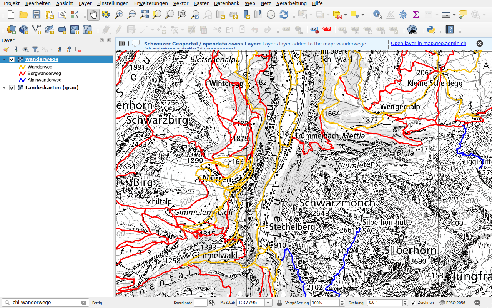

# Swiss Locator

Swiss Locator holt das Geoportal des Bundes in QGIS. Geben Sie in der
Suchleiste von QGIS einen Begriff ein, wie auf
[map.geo.admin.ch](https://map.geo.admin.ch), und finden Sie:

- **Orte**: Kantone, Gemeinden, Bezirke, Postleitzahlen, Adressen, Parzellen
  und die Namen der Landeskarte;
- **Kartenlayer** des Geoportals des Bundes und der kantonalen Dienste, die
  auf [opendata.swiss](https://opendata.swiss) referenziert sind, als WMS oder
  WMTS;
- **Basiskarten** von swisstopo, als Vektorkacheln;
- **Objekte** aus den Layern des Geoportals, etwa eine Haltestelle des
  öffentlichen Verkehrs oder eine Berghütte;
- **Dateien zum Herunterladen** aus den Datenkatalogen des Geoportals und von
  [viageo.ch](https://viageo.ch), für Kantone und Gemeinden (STAC).

Zudem zeichnet das Plugin das Gelände von swissALTI3D in die **Höhenprofile**
von QGIS und [geokodiert](geocoding.md) **Adresstabellen** mit der
Verarbeitung.

## Loslegen

1. Öffnen Sie in QGIS **Erweiterungen ▸ Erweiterungen verwalten und installieren…**,
   suchen Sie nach *Swiss Locator* und installieren Sie es. Es benötigt
   QGIS 3.44 oder neuer.
2. Klicken Sie in die Suchleiste unten links im Fenster oder drücken Sie
   ++ctrl+k++.
3. Geben Sie einen Ort ein, etwa `Lausanne`, und doppelklicken Sie auf ein
   Resultat.

[Erste Schritte](getting-started.md) erklärt die Suchleiste. Danach können
Sie [Orte und Objekte suchen](search/index.md),
[Layer hinzufügen](layers/index.md) oder
[Daten herunterladen](downloads.md).

## Über das Plugin

Das Plugin wird von [OPENGIS.ch](https://opengis.ch) mit Unterstützung der
[QGIS-Anwendergruppe Schweiz](https://qgis.ch) entwickelt. Sein Code liegt auf
[GitHub](https://github.com/opengisch/qgis-swiss-locator), wo Sie auch Probleme
melden können.
