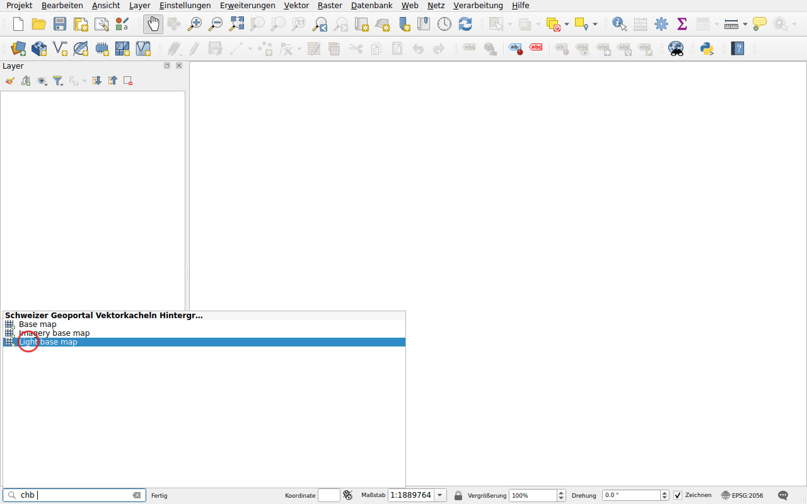
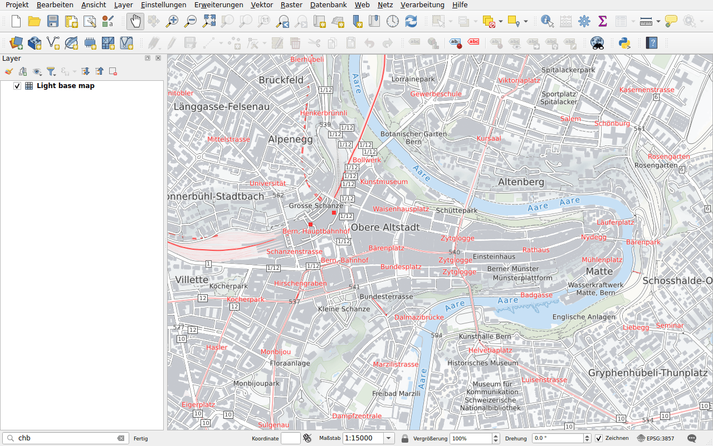

# Basiskarten

Präfix: `chb`

Fügen Sie eine Basiskarte von swisstopo als Vektorkacheln hinzu:

- **Base map**, farbig;
- **Light base map**, in Hellgrau, um Ihre Daten hervorzuheben;
- **Imagery base map**, Luftbilder mit Strassen und Namen.

Vektorkacheln bleiben in jedem Massstab scharf.

## Beispiel

Geben Sie `chb` gefolgt von einem Leerzeichen ein: Die drei Basiskarten werden
aufgelistet.

Doppelklicken Sie auf **Light base map**. Sie wird zuunterst in die Layerliste
eingefügt, unter Ihren Daten.

