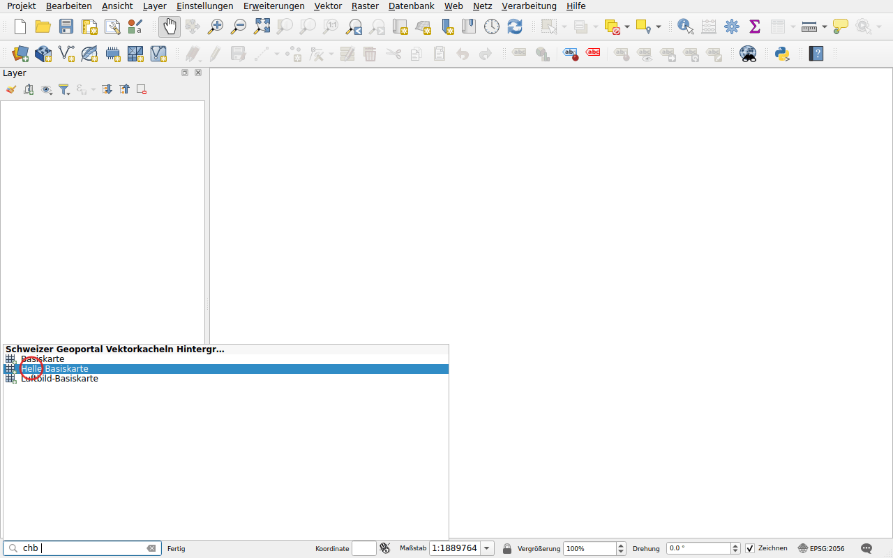
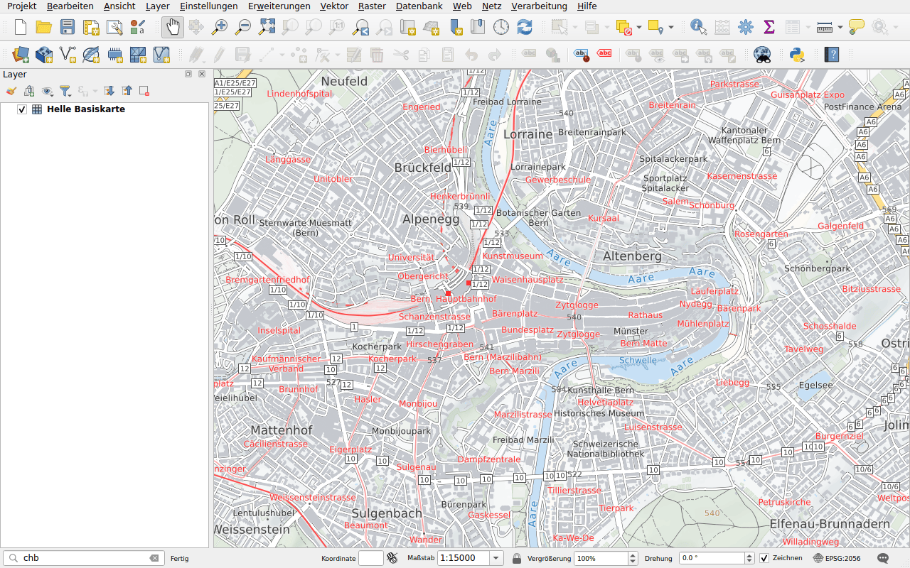

# Basiskarten

Präfix: `chb`

Fügen Sie eine Basiskarte von swisstopo als Vektorkacheln hinzu:

- **Basiskarte**, farbig;
- **Helle Basiskarte**, in Hellgrau, um Ihre Daten hervorzuheben;
- **Luftbild-Basiskarte**, Luftbilder mit Strassen und Namen.

Vektorkacheln bleiben in jedem Massstab scharf.

Wird eine Basiskarte einem leeren Projekt hinzugefügt, setzt sie das Projekt
auf LV95 (EPSG:2056) statt auf Web Mercator, das KBS der Kacheln. Ist
**Voreingestelltes KBS verwenden** unter **Einstellungen ▸ Optionen ▸ KBS und
Transformation ▸ KBS-Behandlung** gewählt, behält das Projekt dieses KBS.

## Beispiel

Geben Sie `chb` gefolgt von einem Leerzeichen ein: Die drei Basiskarten werden
aufgelistet.

Doppelklicken Sie auf **Helle Basiskarte**. Sie wird zuunterst in die
Layerliste eingefügt, unter Ihren Daten.

