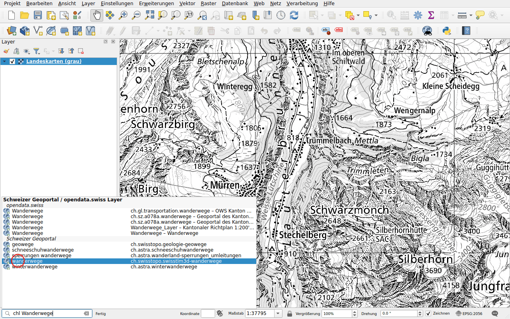
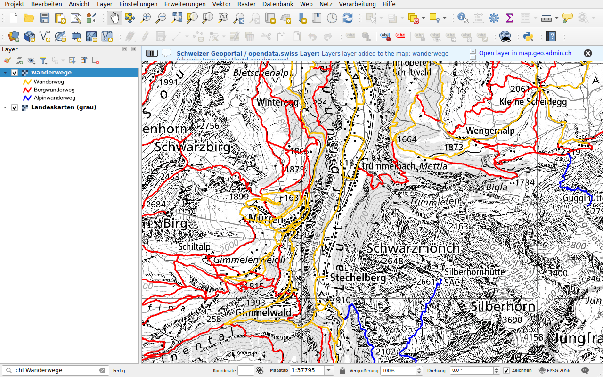
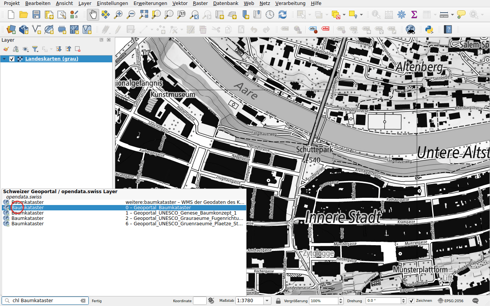
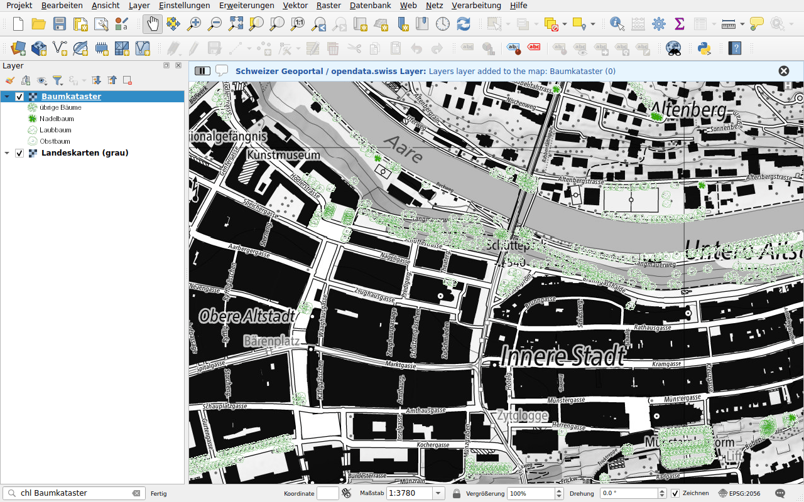

# WMS-Layer

Präfix: `chl`

Finden Sie einen Kartenlayer über seinen Namen oder Titel und fügen Sie ihn als
WMS zur Karte hinzu. Die Suche umfasst:

- die Layer des Geoportals des Bundes, map.geo.admin.ch;
- die Layer der WMS-Dienste von Kantonen, Städten und anderen Organisationen,
  die auf [opendata.swiss](https://opendata.swiss) referenziert sind.

## Beispiel: ein Layer des Geoportals

Geben Sie `chl Wanderwege` ein. Die Layer des Geoportals werden mit ihrer
Kennung aufgelistet, dazu kommen Layer von opendata.swiss.

Doppelklicken Sie auf **wanderwege**. Der Layer wird mit seiner Legende zur
Karte hinzugefügt. Eine Meldung bietet an, den Layer auf map.geo.admin.ch zu
öffnen.

## Beispiel: ein Layer eines kantonalen Dienstes

Kantone und Städte veröffentlichen eigene WMS-Dienste, die auf opendata.swiss
referenziert sind. Ihre Layer werden über den Titel gefunden, aber auch über
den Namen, etwa `ch.gl.transportation.wanderwege`. Die Resultate erscheinen
unter **opendata.swiss**, mit dem Namen des Layers und dem Titel seines
Dienstes.

Geben Sie `chl Baumkataster` ein, um den Baumkataster der Stadt Bern zu finden.

Doppelklicken Sie auf einen Layer des Dienstes *Geoportal_Baumkataster*: Die
Bäume von Bern erscheinen auf der Karte.

!!! note
    Die Layer der auf opendata.swiss referenzierten Dienste sind in einer Datei
    aufgeführt, die mit dieser Dokumentation veröffentlicht wird und die QGIS
    höchstens einmal täglich herunterlädt, siehe [Datenquellen](../data-sources.md).
    Ein Layer, der einem Dienst hinzugefügt wurde, erscheint nach der nächsten
    Aktualisierung der Liste.

Die Suche in opendata.swiss lässt sich in der
[Konfiguration](../configuration.md) ausschalten.
