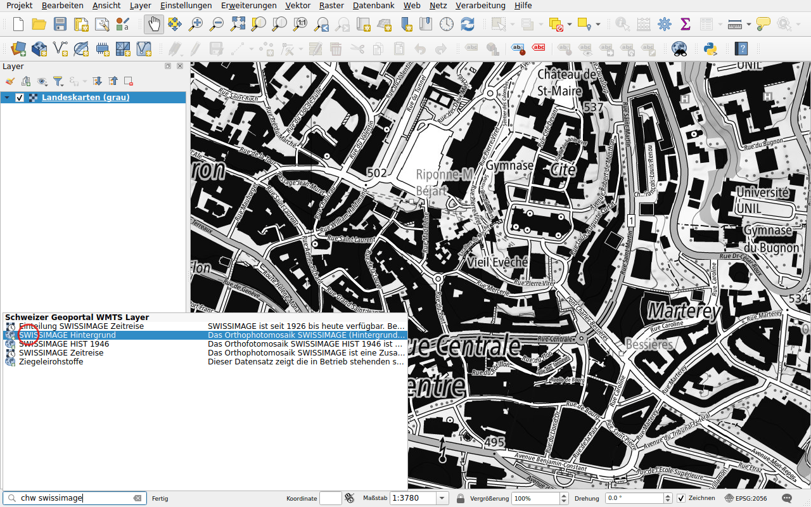
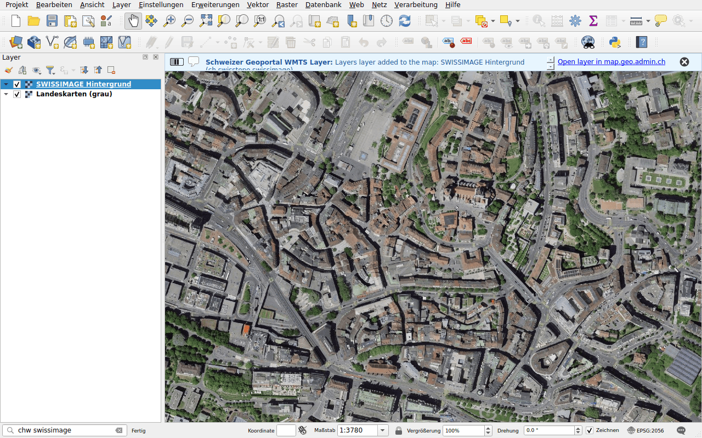

# WMTS-Layer

Präfix: `chw`

Finden Sie einen Layer des WMTS-Dienstes des Geoportals, wmts.geo.admin.ch, und
fügen Sie ihn zur Karte hinzu. Da diese Layer gekachelt sind, werden sie
schneller angezeigt als WMS. Die Suche berücksichtigt die Kennung, den Titel
und die Beschreibung jedes Layers.

## Beispiel: Luftbilder

Geben Sie `chw swissimage` ein.

Doppelklicken Sie auf **SWISSIMAGE Hintergrund**, die Luftbilder von swisstopo.

## Layer mit Zeitständen

Layer mit mehreren Zeitständen, wie *Zeitreise*, haben ein Uhrsymbol. QGIS
fügt sie als zeitabhängige Layer hinzu: Wählen Sie das Datum im
Bedienfeld **Ansicht ▸ Bedienfelder ▸ Zeitsteuerung**.

!!! note
    Einige Layer des Geoportals lassen sich nur auf map.geo.admin.ch anzeigen.
    Kann ein Layer nicht hinzugefügt werden, weist eine Meldung darauf hin.
