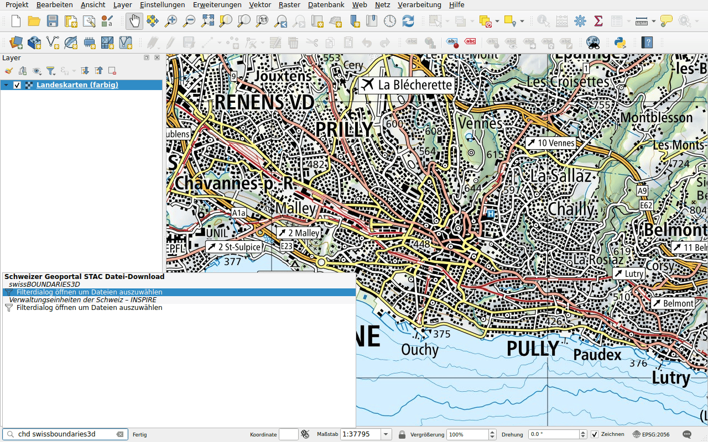
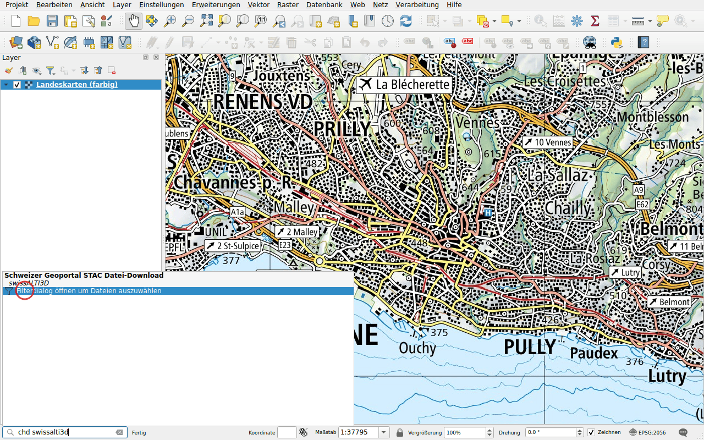
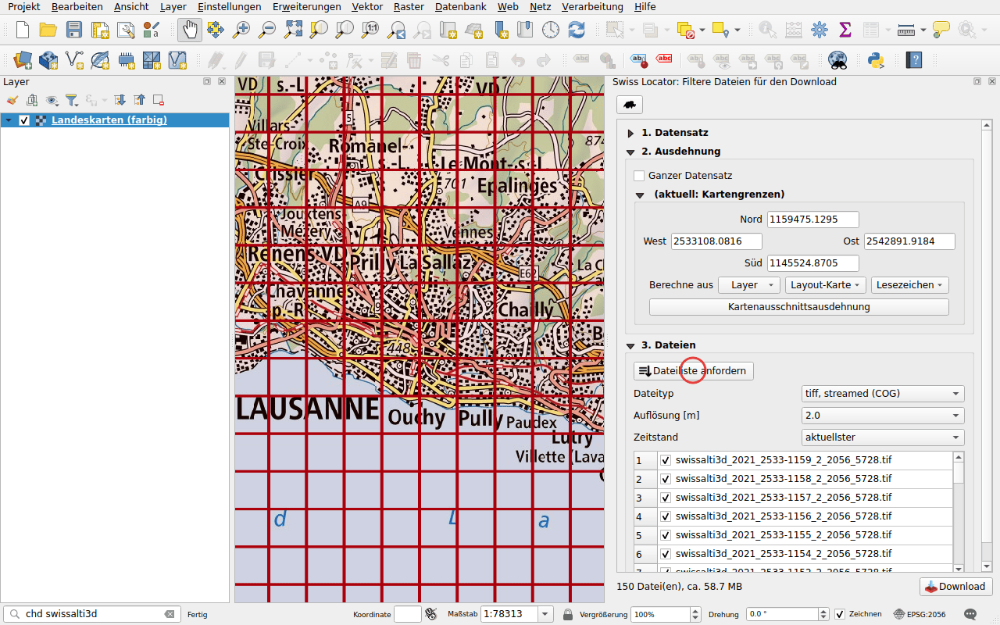

# Datei-Download

Präfix: `chd`

Laden Sie Dateien aus dem Datenkatalog des Geoportals,
[data.geo.admin.ch](https://data.geo.admin.ch), herunter und fügen Sie sie zur
Karte hinzu: Höhenmodelle, Luftbilder, Grenzen, Karten und mehr. Die Suche
berücksichtigt die Namen der Datensätze.

## Ein Datensatz mit wenigen Dateien

Geben Sie `chd swissboundaries3d` ein. Hat ein Datensatz nur wenige Dateien,
werden sie direkt mit ihrem Format aufgelistet.

Doppelklicken Sie auf eine Datei und wählen Sie einen Ordner: Die Datei wird
heruntergeladen und dann zur Karte hinzugefügt. Archive (ZIP) werden nur
heruntergeladen.

Dateien, die QGIS über das Netzwerk lesen kann, etwa Cloud Optimized GeoTIFF,
erscheinen zweimal: Der zweite Eintrag, mit *gestreamt* gekennzeichnet, fügt
die Datei zur Karte hinzu, ohne sie herunterzuladen.

## Ein Datensatz mit vielen Dateien

Geben Sie `chd swissalti3d` ein. Das Höhenmodell ist in Kacheln von einem
Quadratkilometer unterteilt, zu viele für eine Liste: Das Resultat öffnet ein
Filterfenster.

Im Bedienfeld **Swiss Locator: Filtere Dateien für den Download**:

1. **Ausdehnung**: standardmässig die Dateien im aktuellen Kartenausschnitt.
   Möglich sind auch die gesamte Ausdehnung des Datensatzes, die Ausdehnung
   eines Layers, eine Layout-Karte oder ein Lesezeichen.
2. Klicken Sie auf **Dateiliste anfordern** und wählen Sie dann **Dateityp**,
   **Auflösung** und **Zeitstand**. Die Umrisse der Dateien werden auf der
   Karte gezeichnet.
3. Klicken Sie auf **Download**.

Wie viele Dateien direkt in der Suchleiste aufgelistet werden, lässt sich in
der [Konfiguration](../configuration.md) einstellen.
