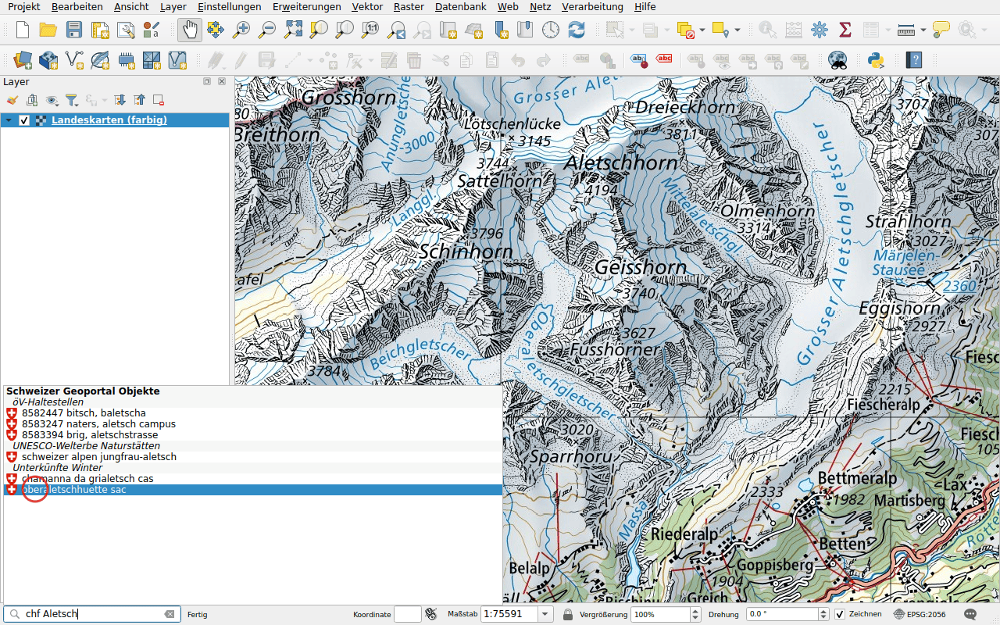
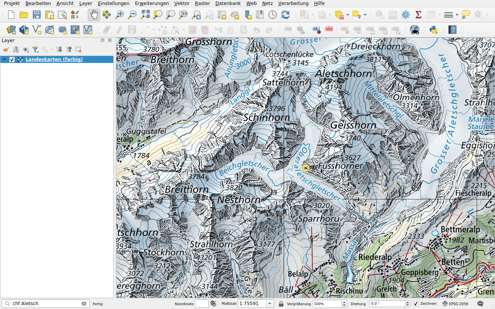

# Objekte

Präfix: `chf`

Finden Sie ein Objekt in den Layern des Geoportals: eine Haltestelle des
öffentlichen Verkehrs, eine Berghütte, ein Objekt der Bundesinventare, einen
Fixpunkt … Die Suche benötigt mindestens vier Zeichen.

## Beispiel

Geben Sie `chf Aletsch` ein. Die Resultate sind nach Layer gruppiert: eine
Haltestelle des öffentlichen Verkehrs, das UNESCO-Welterbe, Berghütten.

Doppelklicken Sie auf **oberaletschhuette sac**. Die Karte zentriert sich auf
die Hütte und markiert sie mit einem Kreis.

## Die zu durchsuchenden Layer wählen

Durchsucht werden die Layer des Geoportals, deren Objekte durchsuchbar sind,
einige Hundert. Um nur einige davon zu durchsuchen, etwa die Haltestellen des
öffentlichen Verkehrs, wählen Sie sie im Reiter **Featuresuche** der
[Konfiguration](../configuration.md#feature-search) aus. Das obige Beispiel
durchsucht vier Layer: die Haltestellen des öffentlichen Verkehrs, die
UNESCO-Welterbestätten, die Unterkünfte im Winter und die Geotope.
