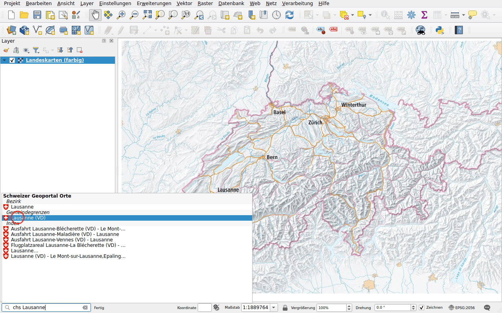
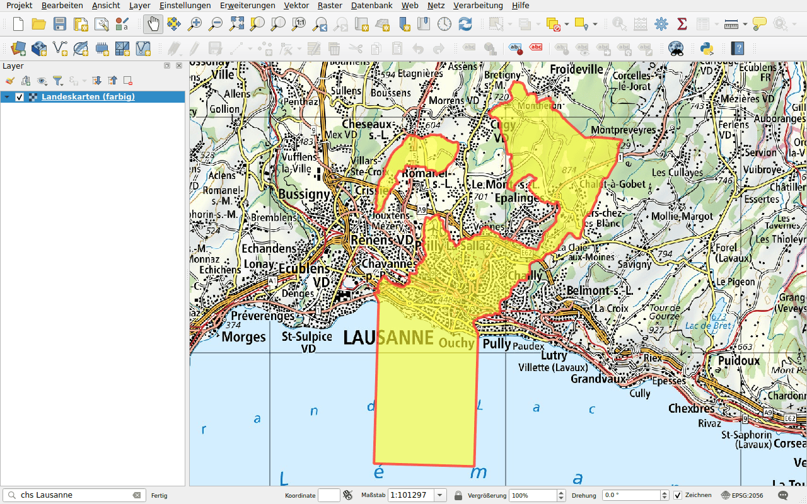
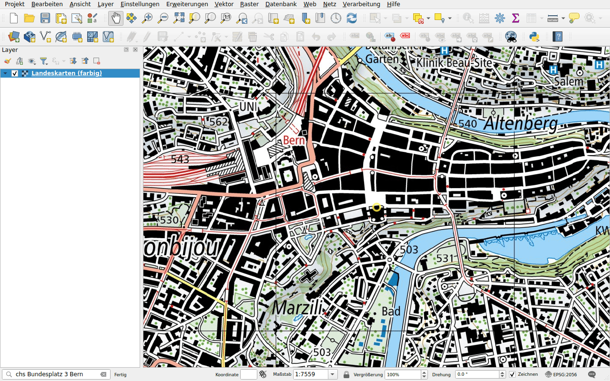

# Orte

Präfix: `chs`

Finden Sie einen Ort wie auf map.geo.admin.ch:

- Kantone, Bezirke und Gemeinden;
- Postleitzahlen;
- Adressen;
- Parzellen;
- die Namen der Landeskarte (swissNAMES3D), etwa ein Gipfel, ein See oder eine
  Autobahnausfahrt.

## Beispiel: eine Gemeinde

Geben Sie `chs Lausanne` ein. Die Resultate sind nach Art gruppiert: der
Bezirk, die Namen der Landeskarte, die Gemeinde.

Doppelklicken Sie unter **Gemeindegrenzen** auf **Lausanne (VD)**. Die Karte
zoomt auf die Gemeinde und zeichnet ihre Grenze.

## Beispiel: eine Adresse

Geben Sie `chs Bundesplatz 3 Bern` ein und wählen Sie die Adresse. Die Karte
zentriert sich auf das Gebäude und markiert es mit einem Kreis.

!!! tip
    Bei einem Punkt, etwa einer Adresse, behält die Karte ihren Massstab.
    Zoomen Sie vorher hinein oder verwenden Sie danach die Zoomwerkzeuge.

Bei einem Ort, dessen Grenze nicht gezeichnet wird, etwa einer Parzelle,
verschwindet die Hervorhebung nach einigen Sekunden.
