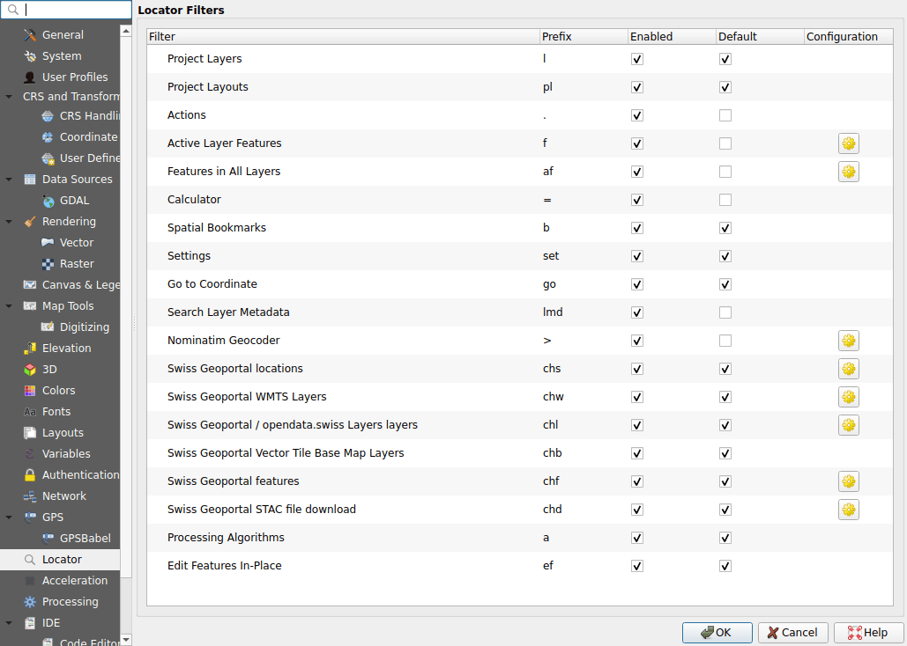
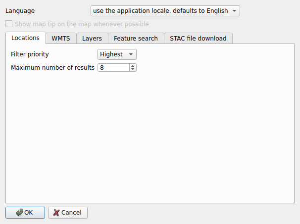
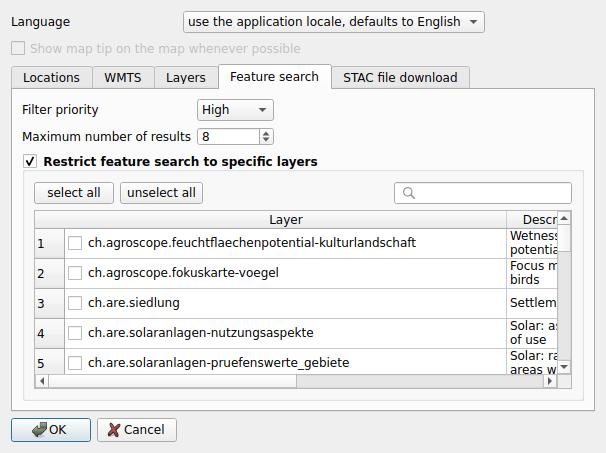

# Configuration

## In the options of QGIS

Open **Settings ▸ Options ▸ Locator**. Each search of the plugin is listed,
with its prefix:

- **Enabled**: uncheck it to turn the search off;
- **Default**: when checked, the search runs without its prefix;
- **Prefix**: can be changed;
- the button on the right opens the configuration of the plugin (the base maps
  have none).

## In the plugin

The configuration of the plugin opens from the button of a search in the
options above.

**Language**
:   The language of the results. By default, that of QGIS when the geoportal
    speaks it, English otherwise.

**Show map tip on the map whenever possible**
:   Shows the information of map.geo.admin.ch on a place or a feature, in a
    bubble over the map. It needs the QtWebKit library, which QGIS 4 does not
    have: the option is then greyed out.

Each search, but the base maps, has its tab:

**Filter priority**
:   The order of the results of the searches in the locator bar.

**Maximum number of results**
:   How many results the search lists.

**Include data from opendata.swiss** (map layers)
:   Also search the layers of the services referenced by opendata.swiss.

**Maximum number of files per result** (file downloads)
:   A dataset with more files than this opens the filter panel instead.

| Search | Priority | Results |
|--------|----------|---------|
| Locations | highest | 8 |
| Map layers | high | 5 |
| WMTS layers | medium | 8 |
| Features | high | 8 |
| File downloads | low | 5, and 5 files per result |

### Feature search

By default, the feature search covers all the layers of the geoportal whose
features can be searched. Check **Restrict feature search to specific layers**
and pick the layers to search: the search box filters the list.

