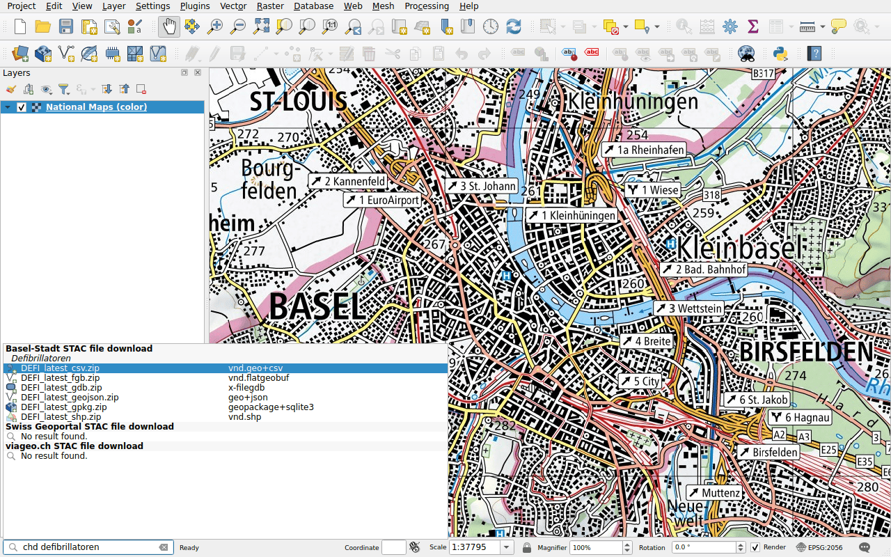

# Data of Basel-Stadt

Prefix: `chd`

The canton of Basel-Stadt publishes its geodata on
[geo.bs.ch](https://www.geo.bs.ch): zoning plans, official survey, cycle
routes, defibrillators and more. Each dataset comes in several formats, all
listed: GeoPackage, GeoJSON, FlatGeobuf, Shapefile, FileGDB, CSV, and for some
DXF and DWG. Its titles are in German: type `chd defibrillatoren`.

Double-click a format and choose a folder: the file, an archive (ZIP), is
downloaded and the dataset it holds is added to the map. QGIS does not always
read DWG and INTERLIS files: the archive is then only downloaded.
