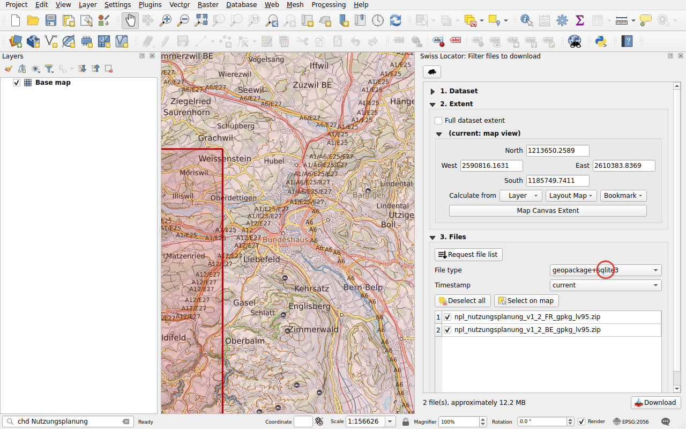

# Data of the cantons (geodienste.ch)

Prefix: `chd`

[geodienste.ch](https://geodienste.ch) publishes the geodata of the cantons in
the data models of the Confederation, the same for every canton: official
survey, zoning plans, hazard maps, structure plans, cadastre of contaminated
sites, wildlife rest areas and some thirty more. Its titles are in German,
French or Italian, in the language of the plugin, in German otherwise: type
`chd Nutzungsplanung`.

Its search runs by default: uncheck it among the
[local catalogues](../configuration.md#in-the-plugin) to leave it out.

A dataset has a file per canton and format: its result opens the
[filter panel](swisstopo.md#a-dataset-with-many-files), which lists the cantons
of the extent. The footprint of a file is the rectangle around its canton. Not
every canton publishes every dataset, and some give theirs only with a login on
geodienste.ch, such as the official survey of Lucerne or Vaud: their download
fails.

Choose the format under **file type**:

- GeoPackage, Shapefile and CSV: the archive (ZIP) is downloaded and the
  datasets it holds are added to the map; a CSV is a table, without geometry.
  Their tables and attributes are named in the language of the catalogue.
- INTERLIS: the archive holds the transfer and its model, and is only
  downloaded; open it with a plugin such as
  [Model Baker](https://opengisch.github.io/QgisModelBaker/). The transfer files
  are listed too, one per municipality for the official survey.

The official survey of a large canton weighs hundreds of megabytes, over a
gigabyte as INTERLIS: for one municipality, take its transfer file.
