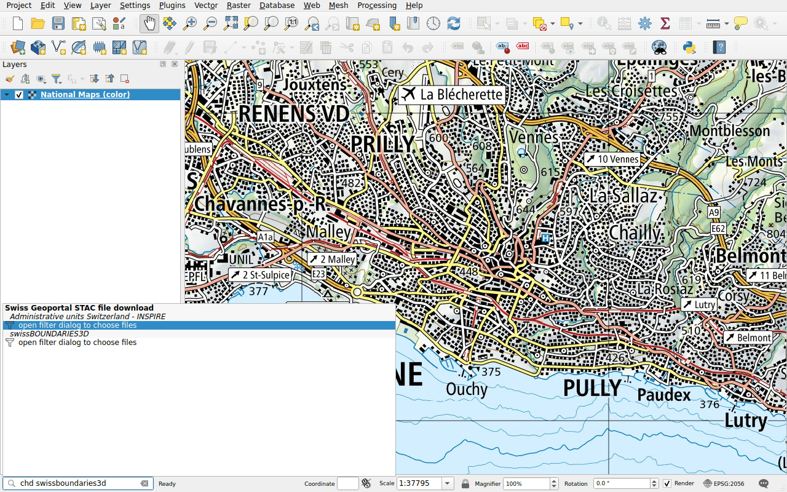
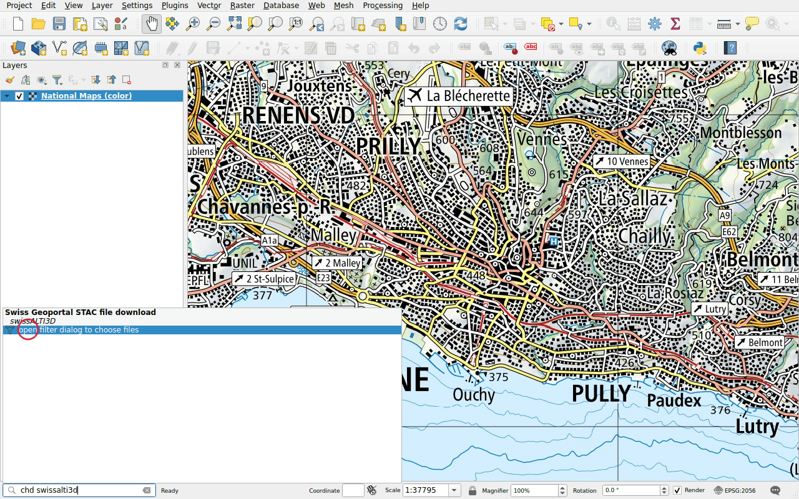
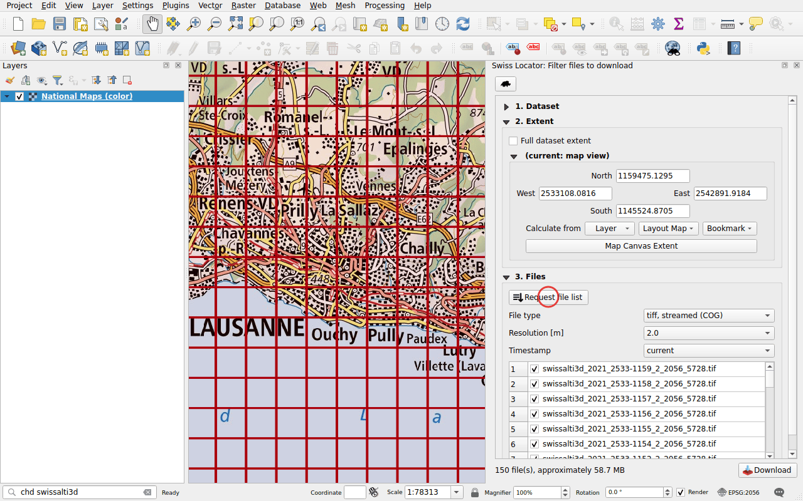

# Downloading data (STAC)

Prefix: `chd`

Download files and add them to the map, from three data catalogues:

- that of the federal geoportal, [data.geo.admin.ch](https://data.geo.admin.ch):
  elevation models, aerial images, boundaries, maps and more;
- [viageo.ch](https://viageo.ch), the geodata of
  [cantons and municipalities](viageo.md);
- [geo.bs.ch](https://www.geo.bs.ch), the geodata of the canton of
  [Basel-Stadt](basel-stadt.md).

The search looks in the names of the datasets. Each catalogue lists its
results under its own name, and is a search of its own in the
[options of QGIS](../configuration.md#in-the-options-of-qgis): uncheck one to
leave it out, or give it a prefix of its own.

## A dataset with a few files

Type `chd swissboundaries3d`. When a dataset has a few files, they are listed
directly, with their format.

Double-click a file and choose a folder: the file is downloaded, then added to
the map. Archives (ZIP) of the geoportal are only downloaded, unless they hold
a point cloud, such as swissSURFACE3D up to 2023: the point cloud is extracted
next to the archive and added to the map. QGIS indexes it before drawing it,
which takes a moment.

Files that QGIS can read over the network, such as Cloud Optimized GeoTIFF and
Cloud Optimized Point Cloud (COPC), are listed twice: the second entry, marked
*streamed*, adds the file to the map without downloading it.

## A dataset with many files

Type `chd swissalti3d`. The elevation model is cut in tiles of one square
kilometre, too many to list: the result opens a filter panel.

In the panel **Swiss Locator: Filter files to download**:

1. **Extent**: the files covering the map view, by default. It can also be the
   full extent of the dataset, the extent of a layer, a print layout map or a
   bookmark.
2. **Request file list**, then choose the **file type**, the **resolution**
   and the **timestamp**. The footprints of the files are drawn on the map.
3. **Download**.

The number of files listed directly in the locator bar can be set in the
[configuration](../configuration.md).
