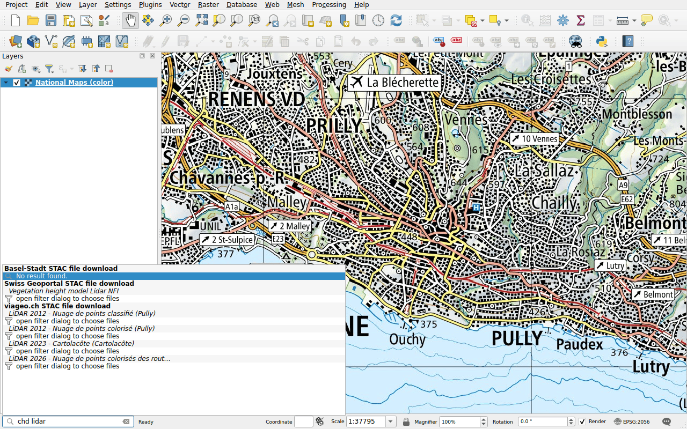

# Cantonal and communal data (viageo.ch)

Prefix: `chd`

[viageo.ch](https://viageo.ch) publishes the data of the canton of Vaud and of
its municipalities: the bathymetry of the lakes, aerial images of 2 cm and
LiDAR point clouds. Its titles are in French: type `lidar`, `orthophoto` or
`bathymétrie`, with the accents.

Its results work [as those of the geoportal](swisstopo.md): an aerial image or a
bathymetry is a single file, to download or to stream; a point cloud opens the
filter panel. Some files are large, such as the aerial image of Pully of June
2026, 35 GB: stream it.
