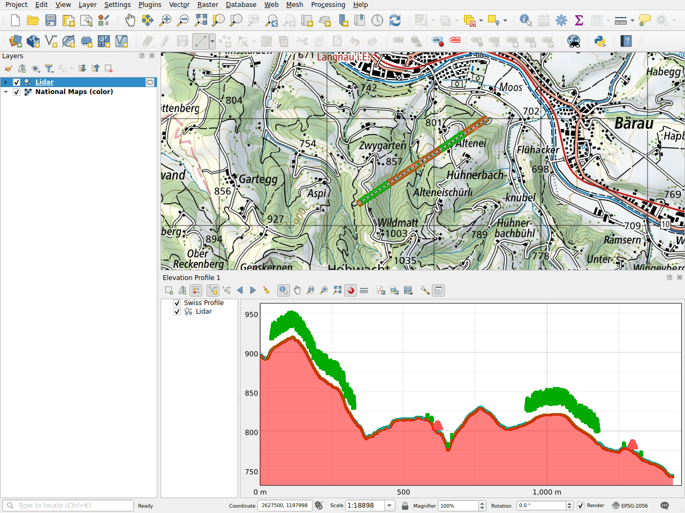

# Elevation profile

The plugin adds the terrain of swisstopo to the elevation profiles of QGIS.
The heights come from the profile service of the geoportal, which uses the
elevation model swissALTI3D. No layer needs to be loaded: the profile is
computed online for the line you draw.

## Draw a profile

1. Open **View ▸ Elevation Profiles ▸ New Elevation Profile**.
2. Click **Capture Curve** in the toolbar of the profile, then draw the line on
   the map: a click for each vertex, a right-click to finish.
3. The terrain of swisstopo is drawn as **Swiss Profile**, in red.

## Example: with a lidar point cloud

The profile shows the layers of the project together with the terrain. Here, a
point cloud along a line of 1.4 km in the hills of Langnau im Emmental: the
ground, the trees and the roofs of two farmhouses stand on the terrain of
swissALTI3D.

!!! note
    The point cloud of this example is made up for the documentation. Real
    ones, such as swissSURFACE3D, can be downloaded with the
    [download](downloads/index.md) search.

In the layer tree of the profile, uncheck **Swiss Profile** to hide the
terrain, or drag it to change the drawing order.

## In a print layout

Like the other layers of a profile, the Swiss Profile can be shown by the
**Elevation Profile** item of print layouts.
