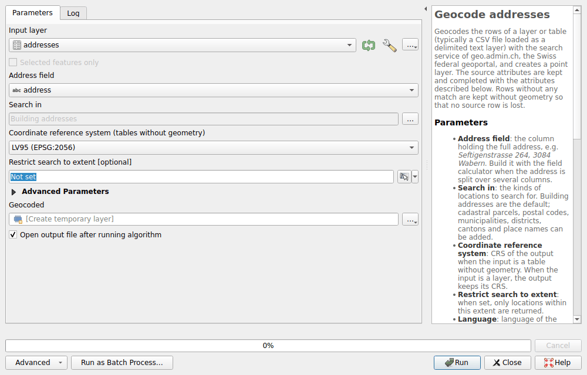
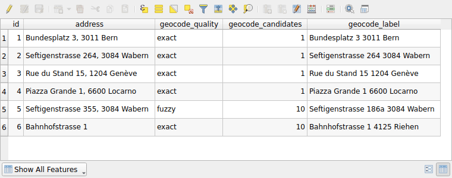

# Geocoding

Turn a table of addresses, such as a CSV file, into a point layer. The
Processing algorithm **Geocode addresses** looks for each address with the
search of the geoportal, the one of the [location search](search/locations.md),
and keeps the columns of the table.

## Geocode a table

1. Load the table. For a CSV file: **Layer ▸ Add Layer ▸ Add Delimited Text
   Layer…**, with **No geometry (attribute only table)** as **Geometry
   Definition**.
2. Open **Processing ▸ Toolbox**, then **Swiss Locator ▸ Geocoding ▸ Geocode
   addresses**.
3. Choose the table as **Input layer**, and the column holding the whole
   address as **Address field**, such as `Seftigenstrasse 264, 3084 Wabern`.
4. Click **Run**. The points are added to the map as **Geocoded**.



When the address is split over several columns, join them first with the
**Field Calculator**, for instance
`concat("street", ' ', "number", ', ', "zip", ' ', "city")`.

The other parameters:

- **Search in**: building addresses by default. Parcels, postal codes,
  municipalities, districts, cantons and the names of the national map can be
  added.
- **Coordinate reference system (tables without geometry)**: LV95 or LV03. A
  layer with a geometry keeps its own.
- **Restrict search to extent**: only the locations within it are found.
- Under **Advanced Parameters**, the **Language** of the labels, and the
  **Pause between requests (milliseconds)**: see [fair use](#fair-use).

## The result

Each row gives a point, with the columns of the table and these attributes:

| Attribute | Content |
|-----------|---------|
| `geocode_quality` | `exact` when every word of the address is in the location found, `fuzzy` otherwise |
| `geocode_candidates` | The number of locations found, up to 10. More than one means that the address is ambiguous: the best one is kept. |
| `geocode_label` | The location found |
| `geocode_detail`, `geocode_origin`, `geocode_feature_id`, `geocode_rank`, `geocode_weight` | The location as returned by the service. For an address, the feature id holds the EGID and EDID of the Federal Register of Buildings and Dwellings. |

A row without any location found, or whose request failed, is kept without a
geometry: no row is lost. The log of the algorithm lists them.



!!! warning
    The search is fuzzy: it almost always finds a location, even for a typo or
    an address that does not exist. Check `geocode_quality` before trusting a
    point. Above, there is no Seftigenstrasse 355 in Wabern: number 186a is
    found and rated `fuzzy`. `Bahnhofstrasse 1` is `exact`, but has 10
    candidates: without a postal code or a locality, it could be any of them.

To be rated `exact`, a number of the address, such as the house number or the
postal code, must be in `geocode_label`. A word, such as the municipality or
the canton, can also be in `geocode_detail`.

The service searches up to ten words: only the first ten words of a longer
address are sent.

## Fair use

The services of geo.admin.ch are free of charge, subject to a
[fair use policy](https://www.geo.admin.ch/en/general-terms-of-use-fsdi) of
about 20 requests per minute. The algorithm therefore pauses for 3 seconds
between two requests: a thousand addresses take about 50 minutes. Identical
addresses are requested only once.

A request that fails because of the network or of an overloaded service is
tried again, up to three times. After five such failures in a row, the
algorithm stops: the service is most likely down.

For larger tables, write to [info@geo.admin.ch](mailto:info@geo.admin.ch)
first, as the terms of use ask, or use the official directory of building
addresses of swisstopo, a dataset of the [data catalogue](downloads/index.md).

## In models and scripts

The algorithm also runs in the model designer, in the batch processing
interface, and from Python:

```python
processing.run(
    "swiss_locator:geocodeaddresses",
    {"INPUT": layer, "FIELD": "address", "OUTPUT": "TEMPORARY_OUTPUT"},
)
```
