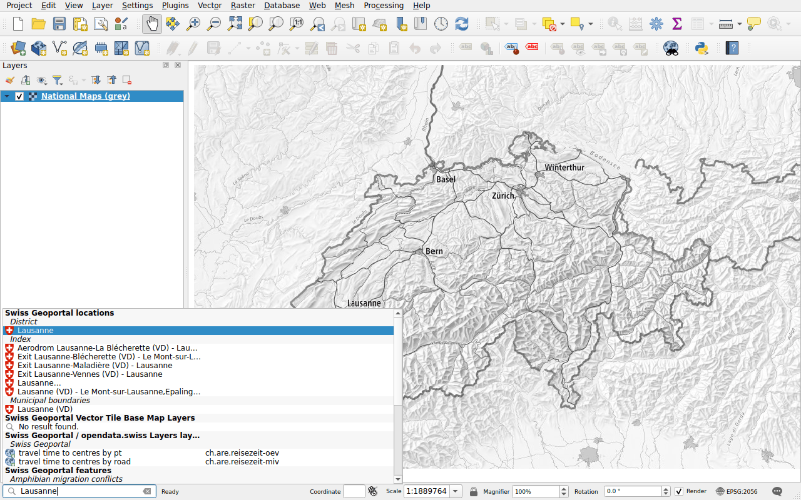
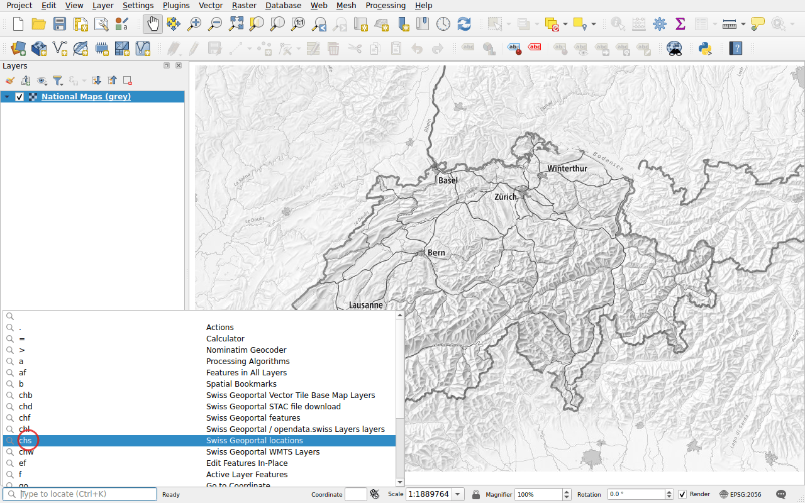

# Getting started

## Install

In QGIS, open **Plugins ▸ Manage and Install Plugins**, search for
*Swiss Locator* and click **Install Plugin**. The plugin needs QGIS 3.44 or
newer, QGIS 4 included.

## Search

The locator bar is at the bottom left of the QGIS window. Click in it, or press
++ctrl+k++, and type at least two characters. The results come in as the
services answer, grouped by kind.

Double-click a result, or select it with the arrow keys and press ++enter++:

- a place or a feature: the map moves to it and highlights it;
- a layer or a base map: it is added to the map;
- a file: it is downloaded and added to the map.

## Narrow the search with a prefix

Without a prefix, every search of the plugin runs, as well as those of QGIS.
Start with a prefix and a space to run only one of them:

| Prefix | Search |
|--------|--------|
| `chs` | [Locations](search/locations.md) |
| `chl` | [WMS layers](layers/wms.md), from the geoportal and opendata.swiss |
| `chw` | [WMTS layers](layers/wmts.md) |
| `chb` | [Base maps](layers/base-maps.md), as vector tiles |
| `chf` | [Features](search/features.md) |
| `chd` | [Downloading data](downloads.md) |

For instance, `chs Lausanne` only searches the places named Lausanne.

No need to remember them: click in the locator bar without typing anything,
it lists all the searches with their prefix. Double-click one: its prefix is
typed for you.

The prefixes, and which searches run without one, can be changed in the
[options of QGIS](configuration.md#in-the-options-of-qgis).

## Language

The results come in the language of QGIS when the geoportal speaks it: English,
French, German, Italian or Romansh. Otherwise in English. The language can be
set in the [configuration](configuration.md) of the plugin.

## Coordinate reference system

The map can use any coordinate reference system. The plugin requests the
results in LV95 (EPSG:2056), or in LV03 (EPSG:21781) when the project uses it,
and QGIS transforms them.
