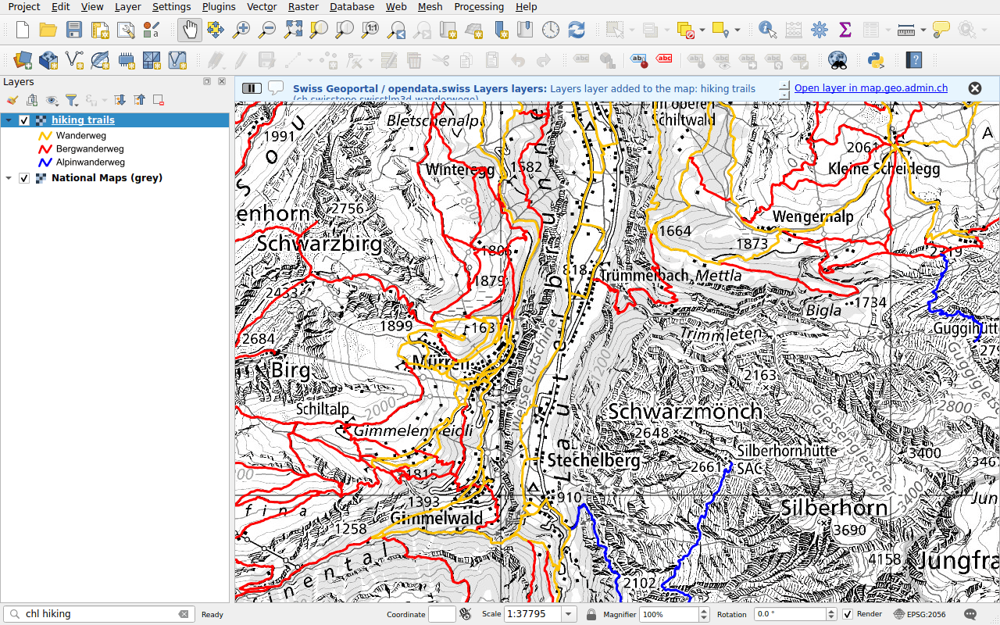

# Swiss Locator

Swiss Locator brings the Swiss Geoportal into QGIS. Type in the locator bar of
QGIS, as you would on [map.geo.admin.ch](https://map.geo.admin.ch), and find:

- **places**: cantons, municipalities, districts, ZIP codes, addresses,
  parcels and the names of the national map;
- **map layers** of the federal geoportal and of the cantonal services
  referenced by [opendata.swiss](https://opendata.swiss), as WMS or WMTS;
- **base maps** of swisstopo, as vector tiles;
- **features** of the layers of the geoportal, such as a public transport stop
  or a mountain hut;
- **files to download** from the data catalogue of the geoportal (STAC).

It also draws the terrain of swissALTI3D in the **elevation profiles** of
QGIS.

## Get started

1. In QGIS, open **Plugins ▸ Manage and Install Plugins**, search for
   *Swiss Locator* and install it. It needs QGIS 3.44 or newer.
2. Click in the locator bar, at the bottom left of the window, or press
   ++ctrl+k++.
3. Type a place, such as `Lausanne`, and double-click a result.

[Getting started](getting-started.md) explains the locator bar. Then
[search for locations and features](search/index.md),
[add layers](layers/index.md) or [download data](downloads.md).

## About

The plugin is developed by [OPENGIS.ch](https://opengis.ch) with the support of
the [Swiss QGIS user group](https://qgis.ch). Its code is on
[GitHub](https://github.com/opengisch/qgis-swiss-locator), where you can report
issues.
