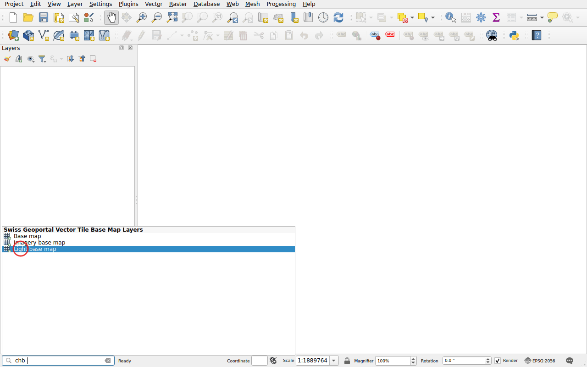
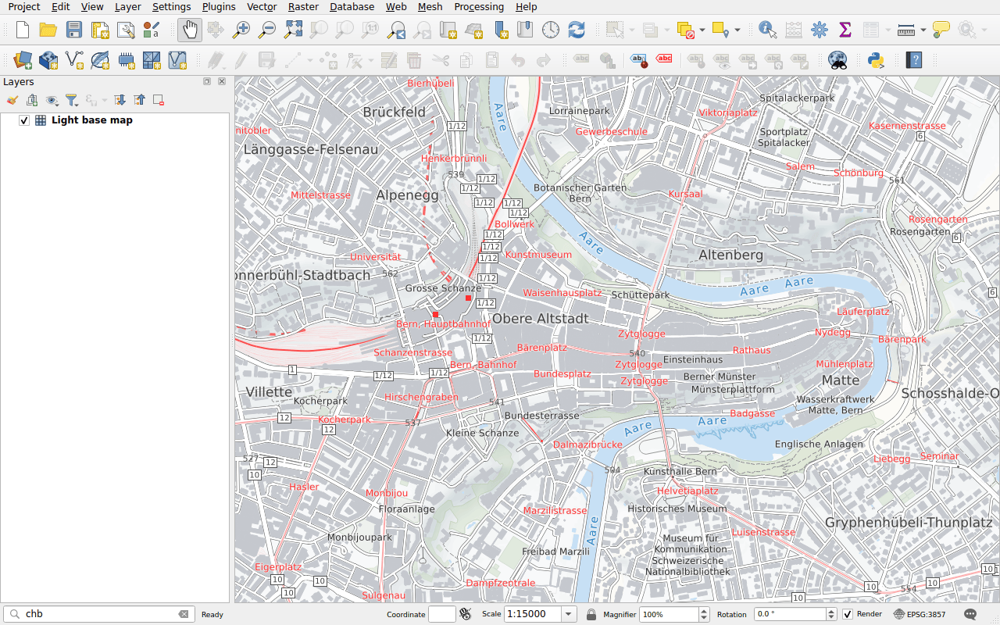

# Base maps

Prefix: `chb`

Add a base map of swisstopo, as vector tiles:

- **Base map**, in colour;
- **Light base map**, in light grey, to put your data forward;
- **Imagery base map**, aerial imagery with roads and names.

Vector tiles stay sharp at any scale.

## Example

Type `chb` followed by a space: the three base maps are listed.

Double-click **Light base map**. It is added at the bottom of the layers, under
your data.

