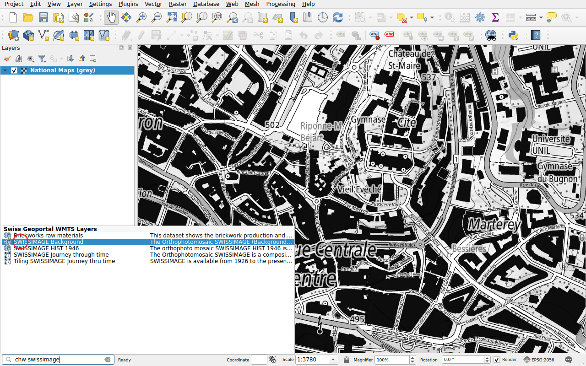
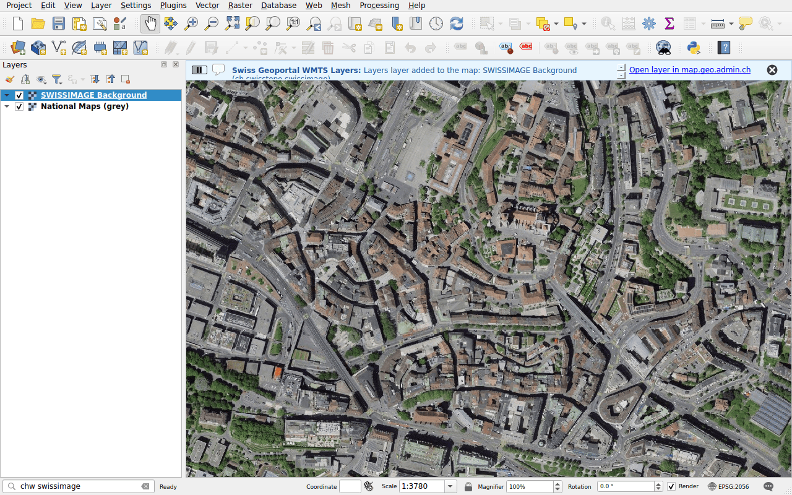

# WMTS layers

Prefix: `chw`

Find a layer of the WMTS service of the geoportal, wmts.geo.admin.ch, and add
it to the map. Tiled, these layers display faster than WMS. The search looks in
the identifier, the title and the description of each layer.

## Example: aerial imagery

Type `chw swissimage`.

Double-click **SWISSIMAGE Background**, the aerial imagery of swisstopo.

## Layers in time

Layers with several dates, such as *Journey through time*, have a clock icon.
QGIS adds them as temporal layers: choose the date in the panel
**View ▸ Panels ▸ Temporal Controller**.

!!! note
    Some layers of the geoportal can only be displayed on map.geo.admin.ch. When
    a layer cannot be added, a message says so.
