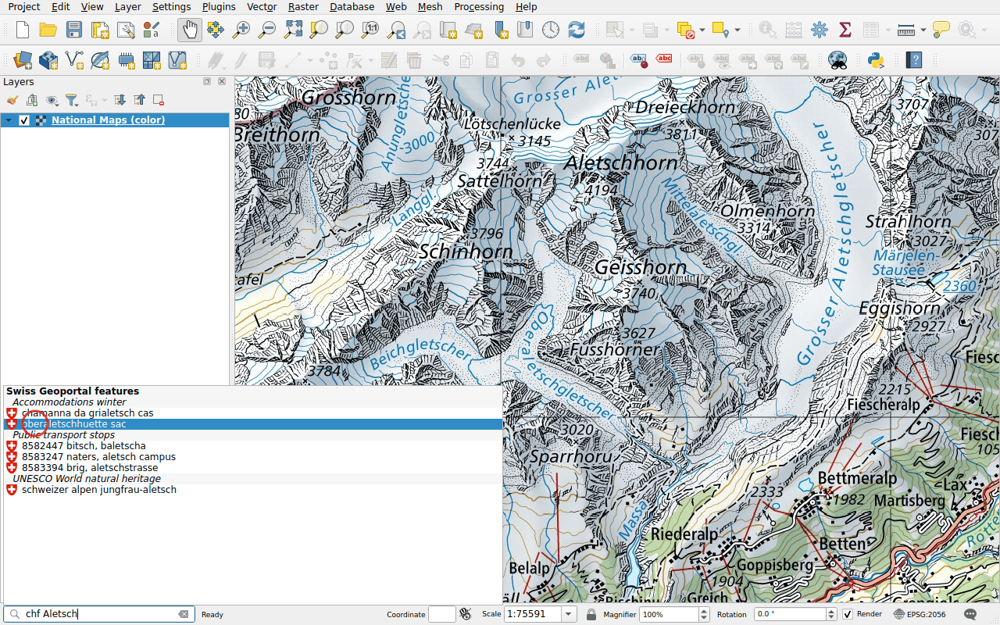
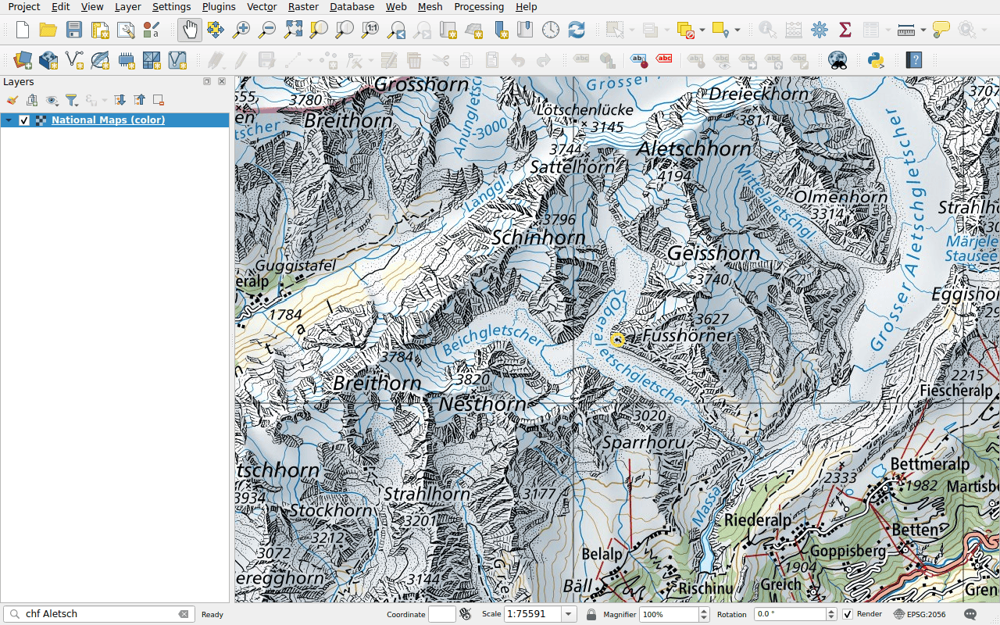

# Features

Prefix: `chf`

Find a feature within the layers of the geoportal: a public transport stop, a
mountain hut, a site of the federal inventories, a control point… The search
needs at least four characters.

## Example

Type `chf Aletsch`. The results are grouped by layer: a public transport stop,
the UNESCO World Heritage site, mountain huts.

Double-click **oberaletschhuette sac**. The map centres on the hut and circles
it.

## Choose the layers to search

The layers searched are those of the geoportal whose features can be searched,
a few hundred. To search only some of them, such as the stops of public
transport, select them in the **Feature search** tab of the
[configuration](../configuration.md#feature-search). The example above searches
four layers: the public transport stops, the UNESCO World Heritage sites, the
winter accommodations and the geosites.
