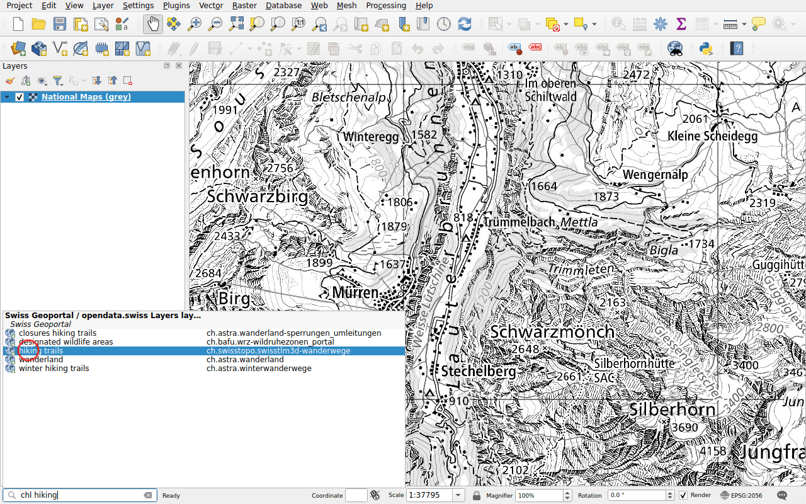
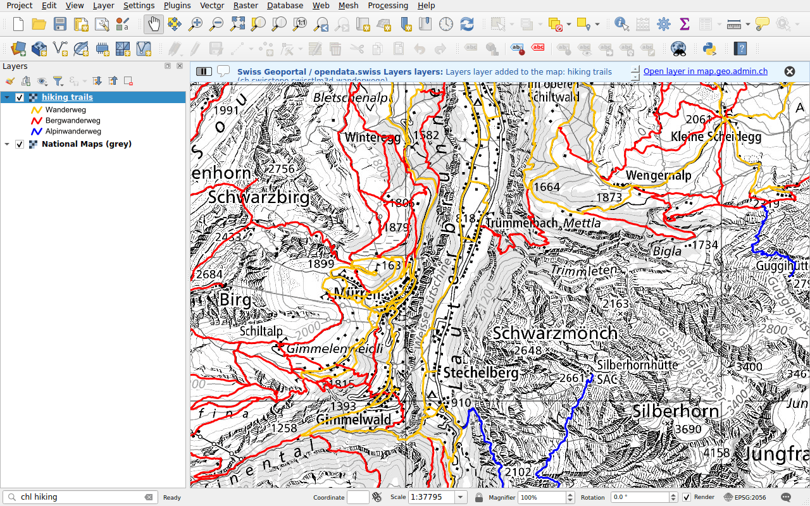
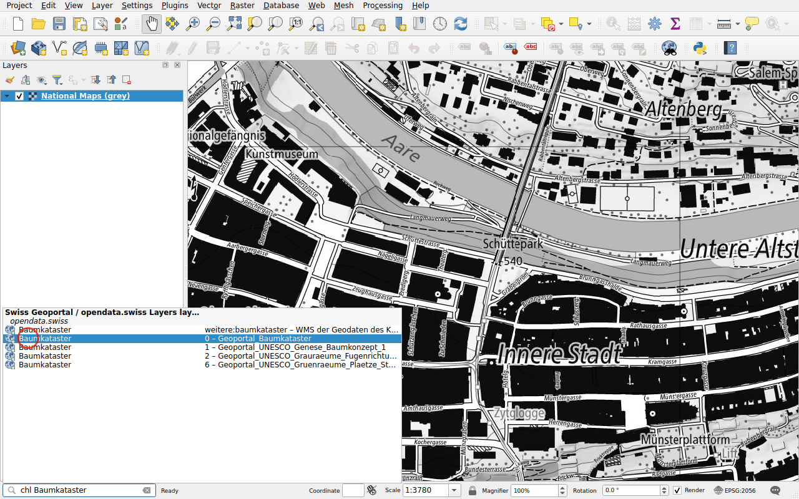
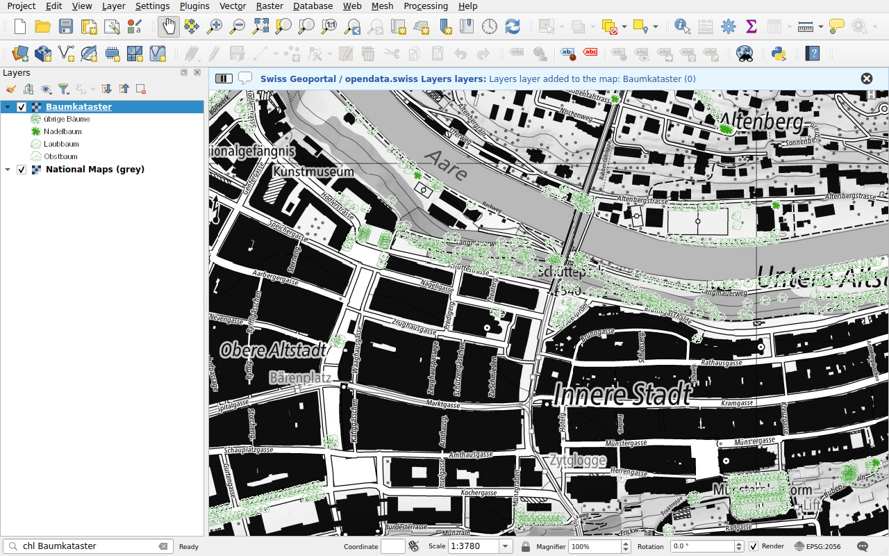

# Map layers

Prefix: `chl`

Find a map layer by its name or title, and add it to the map as WMS. The
search covers:

- the layers of the federal geoportal, map.geo.admin.ch;
- the layers of the WMS services of cantons, cities and other organisations
  referenced by [opendata.swiss](https://opendata.swiss).

## Example: a layer of the geoportal

Type `chl hiking`. The layers of the geoportal are listed with their
identifier.

Double-click **hiking trails**. The layer is added to the map, with its legend.
A message offers to open the layer on map.geo.admin.ch.

## Example: a layer of a cantonal service

Cantons and cities publish their own WMS services, referenced by opendata.swiss.
Their layers are found by title, and by name too, such as
`ch.gl.transportation.wanderwege`. The results come under **opendata.swiss**,
with the name of the layer and the title of its service.

Type `chl Baumkataster`, the tree inventory of the city of Bern.

Double-click a layer of the *Geoportal_Baumkataster* service: the trees of Bern
are on the map.

!!! note
    The layers of the services referenced by opendata.swiss are listed in a
    file published with this documentation, which QGIS downloads at most once a
    day, see [Data sources](../data-sources.md). A layer added to a service
    appears after the next update of the list.

The search of opendata.swiss can be turned off in the
[configuration](../configuration.md).
