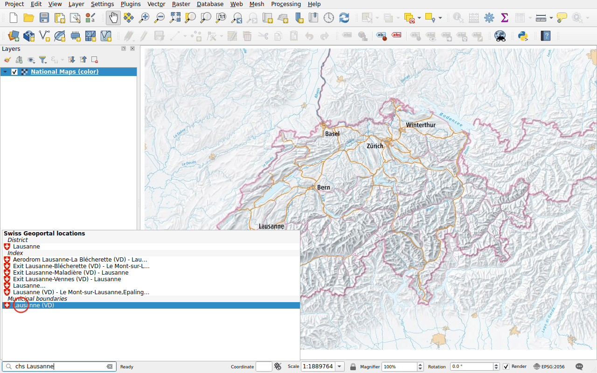
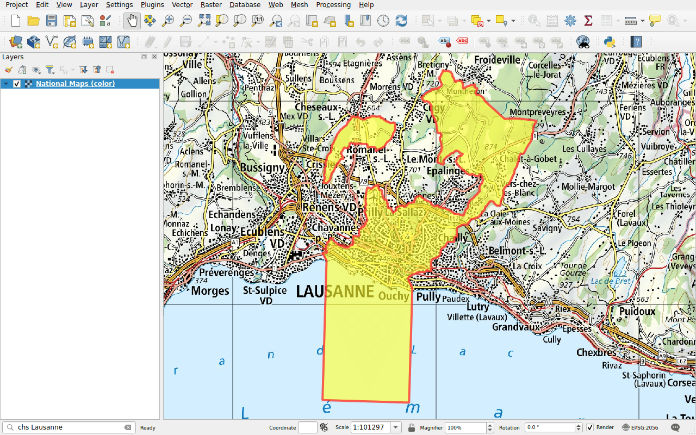
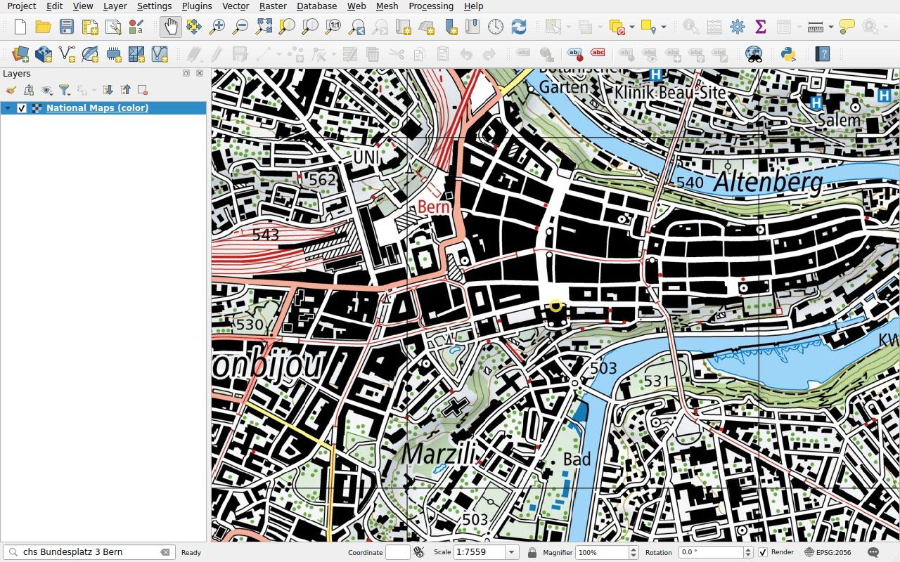

# Locations

Prefix: `chs`

Find a place as on map.geo.admin.ch:

- cantons, districts and municipalities;
- ZIP codes;
- addresses;
- parcels;
- the names of the national map (swissNAMES3D), such as a summit, a lake or a
  motorway exit.

## Example: a municipality

Type `chs Lausanne`. The results are grouped by kind: the district, the names
of the national map, the municipality.

Double-click **Lausanne (VD)** under the municipal boundaries. The map zooms to
the municipality and draws its boundary.

## Example: an address

Type `chs Bundesplatz 3 Bern` and pick the address. The map centres on the
building and circles it.

!!! tip
    For a point, such as an address, the map keeps its scale. Zoom in first,
    or use the zoom tools afterwards.

The highlight of a place whose boundary the plugin does not draw, such as a
parcel, disappears after a few seconds.
