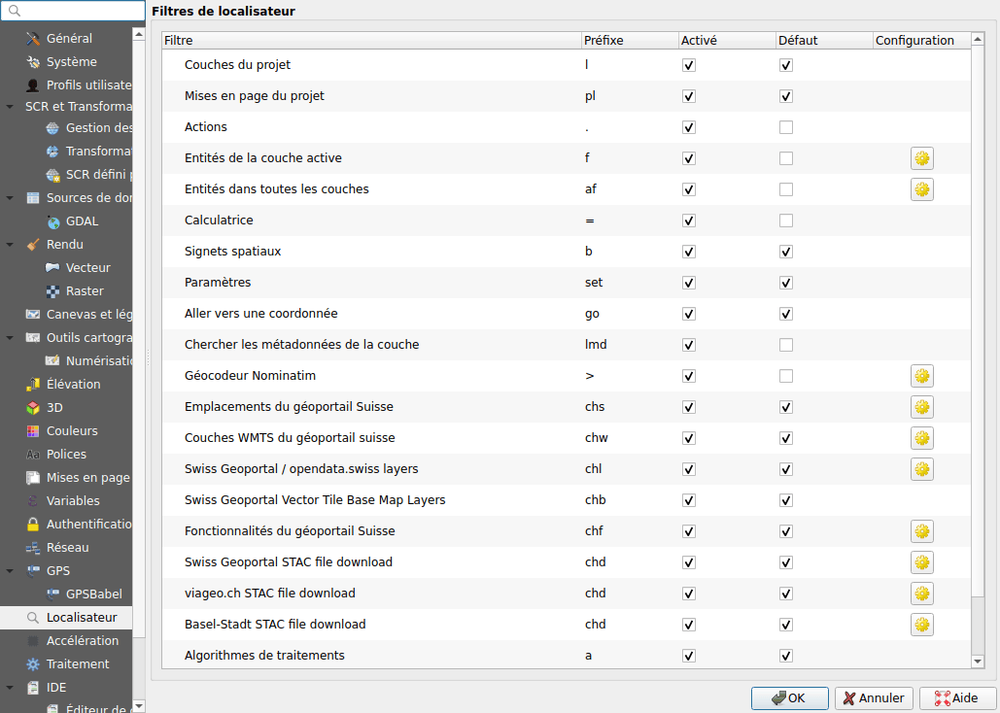
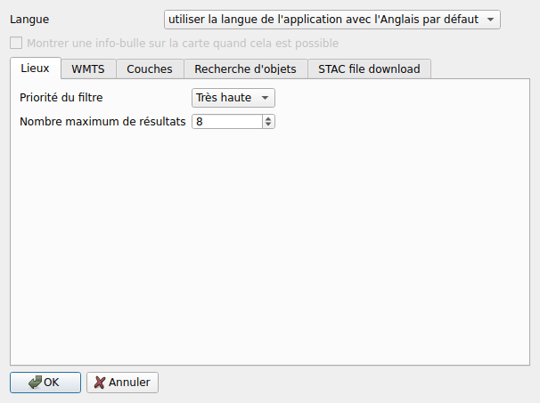
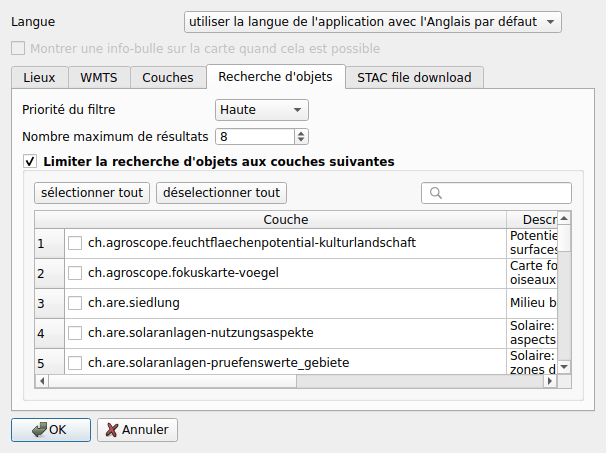

# Configuration

## Dans les options de QGIS {#in-the-options-of-qgis}

Ouvrez **Préférences ▸ Options ▸ Localisateur**. Chaque recherche de
l'extension y est listée, avec son préfixe :

- **Activé** : décochez la case pour désactiver la recherche;
- **Défaut** : quand la case est cochée, la recherche est lancée sans son
  préfixe;
- **Préfixe** : peut être modifié;
- le bouton de droite ouvre la configuration de l'extension (les fonds de plan
  n'en ont pas).

Le téléchargement de données a une recherche par catalogue, avec le même
préfixe : **Swiss Geoportal STAC file download**,
**viageo.ch STAC file download** et **Basel-Stadt STAC file download**.

## Dans l'extension

La configuration de l'extension s'ouvre depuis le bouton d'une recherche, dans
les options ci-dessus.

**Langue**
:   La langue des résultats. Par défaut, celle de QGIS quand le géoportail la
    propose, l'anglais sinon.

**Montrer une info-bulle sur la carte quand cela est possible**
:   Affiche les informations de map.geo.admin.ch sur un lieu ou un objet, dans
    une bulle au-dessus de la carte. L'option nécessite la bibliothèque
    QtWebKit, que QGIS 4 n'a pas : elle y est alors grisée.

Chaque recherche, sauf les fonds de plan, a son onglet :

**Priorité du filtre**
:   L'ordre des résultats des recherches dans la barre de localisation.

**Nombre maximum de résultats**
:   Le nombre de résultats que la recherche liste.

**Inclure les données de opendata.swiss** (couches WMS)
:   Recherche aussi les couches des services référencés par opendata.swiss.

**Nombre max. de fichiers par résultat** (téléchargement de données)
:   Un jeu de données qui a plus de fichiers ouvre le panneau de filtre au lieu
    de les lister.

| Recherche | Priorité | Résultats |
|-----------|----------|-----------|
| Lieux | très haute | 8 |
| Couches WMS | haute | 5 |
| Couches WMTS | moyenne | 8 |
| Objets | haute | 8 |
| Télécharger des données | basse | 5 par catalogue, et 5 fichiers par résultat |

### Recherche d'objets {#feature-search}

Par défaut, la recherche d'objets couvre toutes les couches du géoportail dont
les objets peuvent être recherchés. Cochez **Limiter la recherche d'objets aux
couches suivantes** et choisissez les couches à rechercher : le champ de
recherche filtre la liste.

