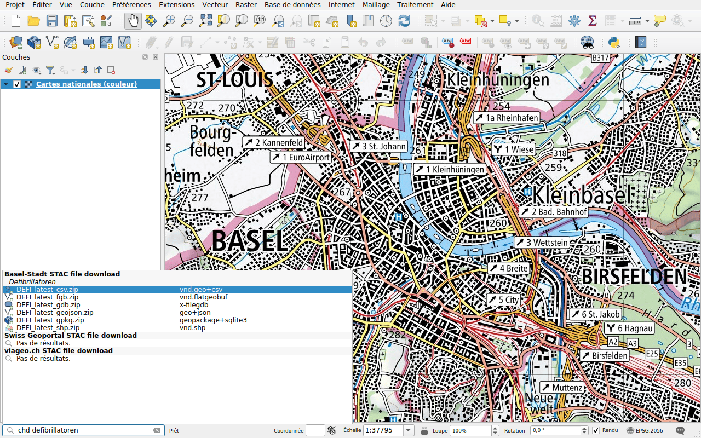

# Données de Bâle-Ville

Préfixe : `chd`

Le canton de Bâle-Ville publie ses géodonnées sur
[geo.bs.ch](https://www.geo.bs.ch) : plans de zones, mensuration officielle,
itinéraires cyclables, défibrillateurs et plus encore. Chaque jeu de données
existe en plusieurs formats, tous listés : GeoPackage, GeoJSON, FlatGeobuf,
Shapefile, FileGDB, CSV, et pour certains DXF et DWG. Ses titres sont en
allemand : tapez `chd defibrillatoren`.

Double-cliquez sur un format et choisissez un dossier : le fichier, une archive
(ZIP), est téléchargé et le jeu de données qu'il contient est ajouté à la
carte. QGIS ne lit pas toujours les fichiers DWG et INTERLIS : l'archive est
alors seulement téléchargée.
