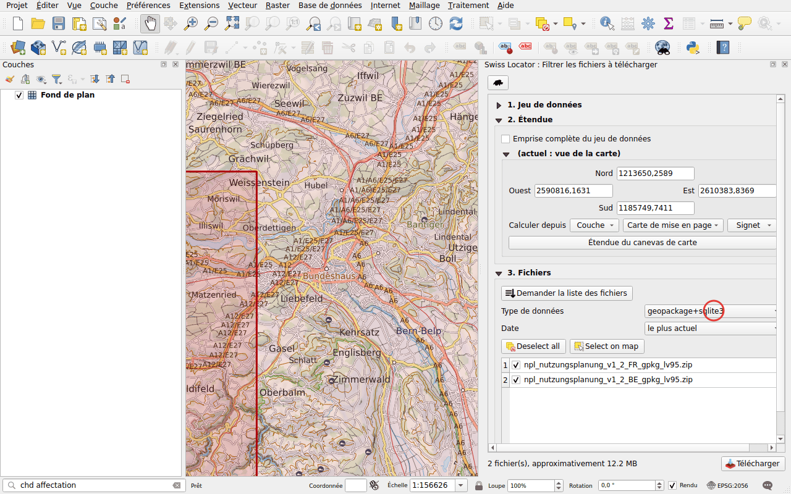

# Données des cantons (geodienste.ch)

Préfixe : `chd`

[geodienste.ch](https://geodienste.ch) publie les géodonnées des cantons dans
les modèles de données de la Confédération, les mêmes pour chaque canton :
mensuration officielle, plans d'affectation, cartes des dangers, plans
directeurs, cadastre des sites pollués, zones de tranquillité pour la faune et
une trentaine d'autres. Ses titres sont en allemand, en français ou en italien,
dans la langue de l'extension, en allemand sinon : tapez `chd affectation`.

Sa recherche est lancée par défaut : décochez-le parmi les
[catalogues locaux](../configuration.md#in-the-plugin) pour l'écarter.

Un jeu de données a un fichier par canton et par format : son résultat ouvre le
[panneau de filtre](swisstopo.md#a-dataset-with-many-files), qui liste les
cantons de l'étendue. L'emprise d'un fichier est le rectangle autour de son
canton. Tous les cantons ne publient pas tous les jeux de données, et certains
ne livrent les leurs qu'avec un compte sur geodienste.ch, comme la mensuration
officielle de Lucerne ou de Vaud : leur téléchargement échoue.

Choisissez le format sous **Type de données** :

- GeoPackage, Shapefile et CSV : l'archive (ZIP) est téléchargée et les jeux de
  données qu'elle contient sont ajoutés à la carte ; un CSV est une table, sans
  géométrie. Leurs tables et attributs sont nommés dans la langue du catalogue.
- INTERLIS : l'archive contient le transfert et son modèle, et est seulement
  téléchargée ; ouvrez-la avec une extension comme
  [Model Baker](https://opengisch.github.io/QgisModelBaker/). Les fichiers de
  transfert sont aussi listés, un par commune pour la mensuration officielle.

La mensuration officielle d'un grand canton pèse des centaines de mégaoctets,
plus d'un gigaoctet en INTERLIS : pour une commune, prenez son fichier de
transfert.
