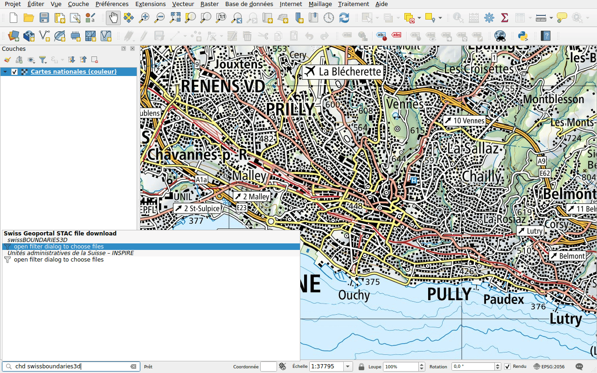
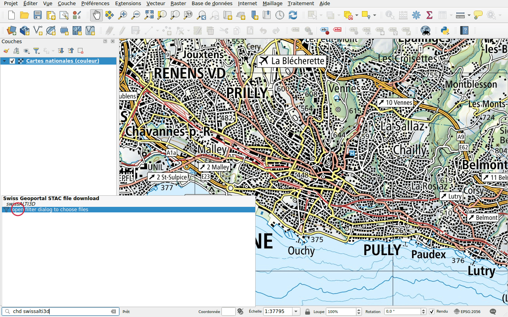
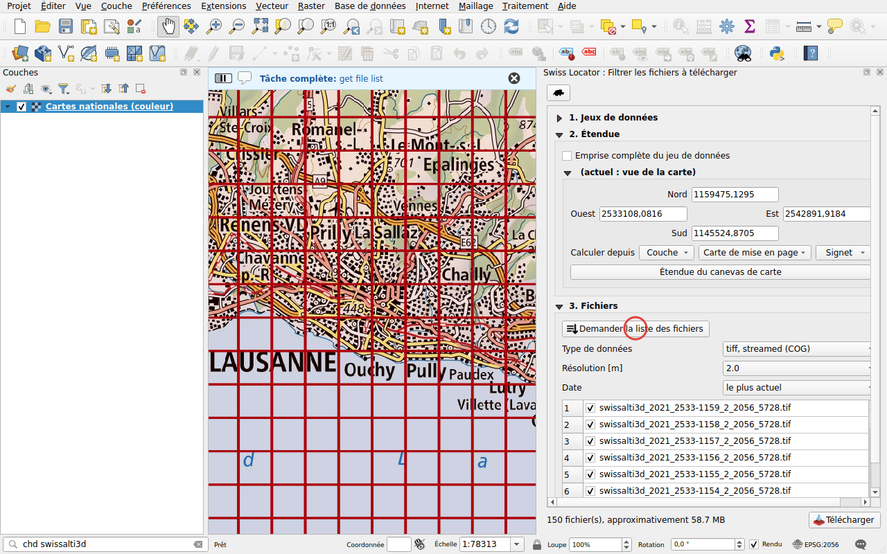

# Télécharger des données (STAC)

Préfixe : `chd`

Téléchargez des fichiers et ajoutez-les à la carte, depuis deux catalogues de
données :

- celui du géoportail fédéral, [data.geo.admin.ch](https://data.geo.admin.ch) :
  modèles altimétriques, images aériennes, limites, cartes et plus encore ;
- [viageo.ch](https://viageo.ch), les géodonnées des
  [cantons et des communes](viageo.md).

La recherche porte sur les noms des jeux de données. Chaque catalogue liste ses
résultats sous son propre nom, et est une recherche à part dans les
[options de QGIS](../configuration.md#in-the-options-of-qgis) : décochez-en un pour
l'écarter, ou donnez-lui son propre préfixe.

## Un jeu de données de quelques fichiers

Tapez `chd swissboundaries3d`. Quand un jeu de données a peu de fichiers, ils
sont listés directement, avec leur format.

Double-cliquez sur un fichier et choisissez un dossier : le fichier est
téléchargé, puis ajouté à la carte. Les archives (ZIP) sont seulement
téléchargées, sauf si elles contiennent un nuage de points, comme
swissSURFACE3D jusqu'en 2023 : le nuage de points est extrait à côté de
l'archive et ajouté à la carte. QGIS l'indexe avant de l'afficher, ce qui prend
un moment.

Les fichiers que QGIS peut lire par le réseau, comme les Cloud Optimized
GeoTIFF et les Cloud Optimized Point Cloud (COPC), sont listés deux fois : la
seconde entrée, marquée *streamed*, ajoute le fichier à la carte sans le
télécharger.

## Un jeu de données de nombreux fichiers

Tapez `chd swissalti3d`. Le modèle altimétrique est découpé en tuiles d'un
kilomètre carré, trop nombreuses pour être listées : le résultat ouvre un
panneau de filtre.

Dans le panneau **Swiss Locator : Filtrer les fichiers à télécharger** :

1. **Étendue** : par défaut, les fichiers qui couvrent la vue de la carte. Ce
   peut aussi être l'emprise complète du jeu de données, l'étendue d'une
   couche, d'une carte de mise en page ou d'un signet.
2. Cliquez sur **Demander la liste des fichiers**, puis choisissez le
   **Type de données**, la **Résolution [m]** et la **Date**. Les emprises des
   fichiers sont dessinées sur la carte.
3. Cliquez sur **Télécharger**.

Le nombre de fichiers listés directement dans la barre de localisation peut
être défini dans la [configuration](../configuration.md).
