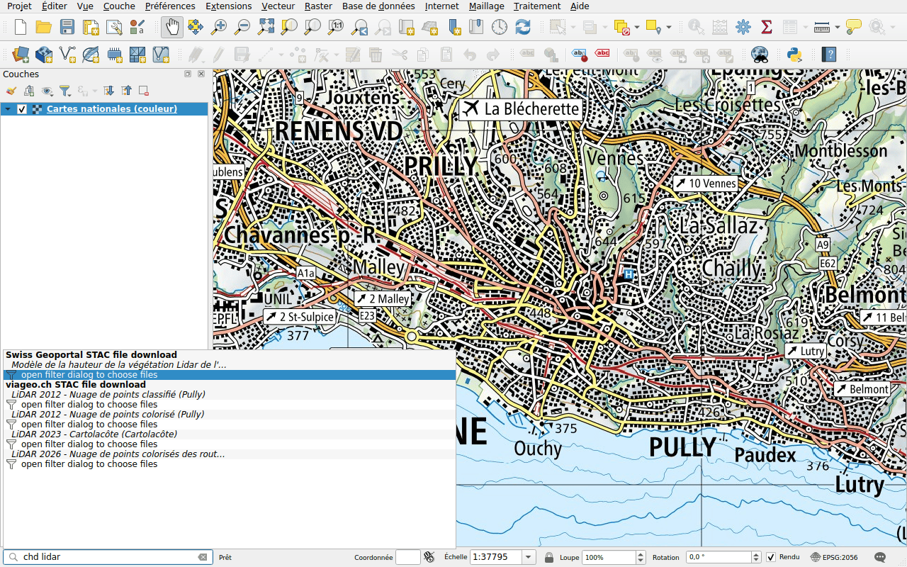

# Données cantonales et communales (viageo.ch)

Préfixe : `chd`

[viageo.ch](https://viageo.ch) publie les données du canton de Vaud et de ses
communes : la bathymétrie des lacs, des images aériennes de 2 cm et des nuages
de points LiDAR. Ses titres sont en français : tapez `lidar`, `orthophoto` ou
`bathymétrie`, avec les accents.

Ses résultats fonctionnent [comme ceux du géoportail](swisstopo.md) : une image
aérienne ou une bathymétrie est un seul fichier, à télécharger ou à ajouter en
*streamed* ; un nuage de points ouvre le panneau de filtre. Certains fichiers
sont gros, comme l'image aérienne de Pully de juin 2026, 35 Go : ajoutez-la en
*streamed*.
