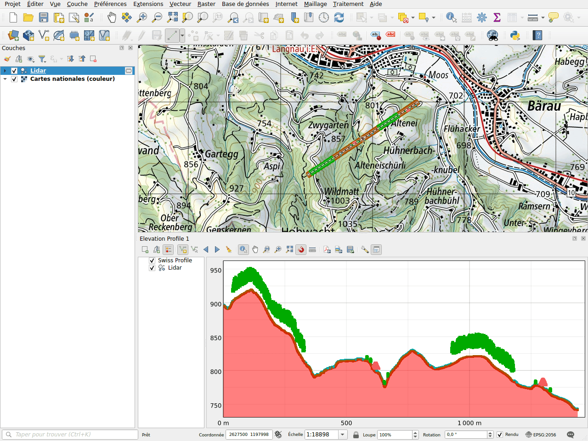

# Profil altimétrique

L'extension ajoute le terrain de swisstopo aux profils d'élévation de QGIS.
Les altitudes proviennent du service de profil du géoportail, qui utilise le
modèle altimétrique swissALTI3D. Aucune couche n'est à charger : le profil est
calculé en ligne pour la ligne que vous dessinez.

## Dessiner un profil

1. Ouvrez **Vue ▸ Elevation Profiles ▸ New Elevation Profile**.
2. Cliquez sur **Dessiner la courbe** dans la barre d'outils du profil, puis
   dessinez la ligne sur la carte : un clic pour chaque sommet, un clic droit
   pour terminer.
3. Le terrain de swisstopo est dessiné en rouge, sous le nom **Swiss Profile**.

## Exemple : avec un nuage de points lidar

Le profil montre les couches du projet avec le terrain. Ici, un nuage de points
le long d'une ligne de 1,4 km dans les collines de Langnau im Emmental : le sol,
les arbres et les toits de deux fermes se dressent sur le terrain de
swissALTI3D.

!!! note
    Le nuage de points de cet exemple est inventé pour la documentation. De
    vrais nuages de points, comme swissSURFACE3D, peuvent être téléchargés avec
    la recherche [Télécharger des données](downloads.md).

Dans l'arborescence des couches du profil, décochez **Swiss Profile** pour
masquer le terrain, ou faites-le glisser pour changer l'ordre de dessin.

## Dans une mise en page

Comme les autres couches d'un profil, Swiss Profile peut être affiché dans une
mise en page par l'élément **Profil d'élévation**.
