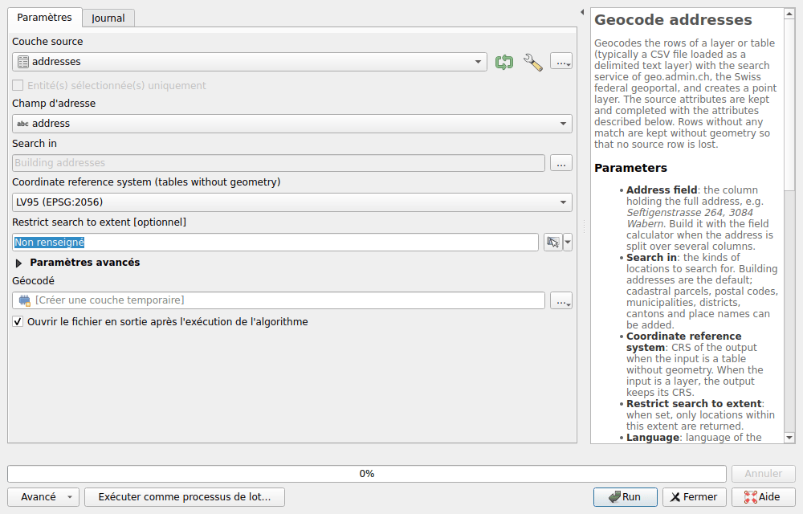
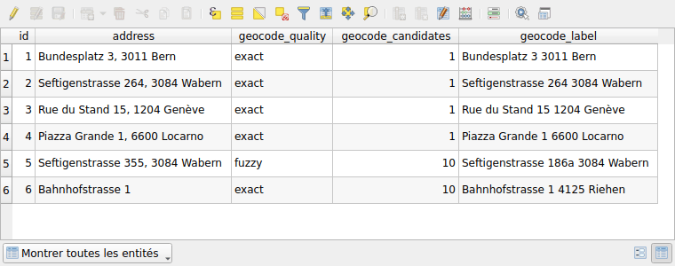

# Géocodage

Transformez une table d'adresses, comme un fichier CSV, en une couche de
points. L'algorithme de traitement **Geocode addresses** cherche chaque adresse
avec la recherche du géoportail, celle de la
[recherche de lieux](search/locations.md), et garde les colonnes de la table.

## Géocoder une table

1. Chargez la table. Pour un fichier CSV : **Couche ▸ Ajouter une couche ▸
   Ajouter une couche de texte délimité…**, avec **Pas de géométrie (juste la
   table)** comme **Définition de la géométrie**.
2. Ouvrez **Traitement ▸ Boîte à outils**, puis **Swiss Locator ▸ Geocoding ▸
   Geocode addresses**.
3. Choisissez la table comme **Couche source**, et la colonne qui contient
   l'adresse complète comme **Champ d'adresse**, par exemple
   `Seftigenstrasse 264, 3084 Wabern`.
4. Cliquez sur **Run**. Les points sont ajoutés à la carte sous le nom
   **Géocodé**.



Quand l'adresse est répartie sur plusieurs colonnes, réunissez-les d'abord avec
la **Calculatrice de champ**, par exemple
`concat("rue", ' ', "numero", ', ', "npa", ' ', "localite")`.

Les autres paramètres :

- **Search in** : les adresses de bâtiments par défaut. Les parcelles, les
  codes postaux, les communes, les districts, les cantons et les noms de la
  carte nationale peuvent être ajoutés.
- **Coordinate reference system (tables without geometry)** : MN95 ou MN03.
  Une couche avec une géométrie garde la sienne.
- **Restrict search to extent** : seuls les lieux situés dans cette emprise
  sont trouvés.
- Sous **Paramètres avancés**, la langue des libellés, **Language**, et la
  pause entre deux requêtes, **Pause between requests (milliseconds)** : voir
  [l'usage équitable](#fair-use).

## Le résultat

Chaque ligne donne un point, avec les colonnes de la table et ces attributs :

| Attribut | Contenu |
|----------|---------|
| `geocode_quality` | `exact` quand chaque mot de l'adresse se trouve dans le lieu trouvé, `fuzzy` sinon |
| `geocode_candidates` | Le nombre de lieux trouvés, jusqu'à 10. Plus d'un signifie que l'adresse est ambiguë : le meilleur est gardé. |
| `geocode_label` | Le lieu trouvé |
| `geocode_detail`, `geocode_origin`, `geocode_feature_id`, `geocode_rank`, `geocode_weight` | Le lieu tel que le renvoie le service. Pour une adresse, l'identifiant contient l'EGID et l'EDID du Registre fédéral des bâtiments et des logements. |

Une ligne sans lieu trouvé, ou dont la requête a échoué, est gardée sans
géométrie : aucune ligne n'est perdue. Le journal de l'algorithme les liste.



!!! warning
    La recherche est approximative : elle trouve presque toujours un lieu, même
    pour une faute de frappe ou une adresse qui n'existe pas. Vérifiez
    `geocode_quality` avant de vous fier à un point. Ci-dessus, il n'y a pas de
    Seftigenstrasse 355 à Wabern : le numéro 186a est trouvé et noté `fuzzy`.
    `Bahnhofstrasse 1` est `exact`, mais a 10 candidats : sans code postal ni
    localité, ce peut être n'importe lequel.

Pour être noté `exact`, un nombre de l'adresse, comme le numéro de la maison ou
le code postal, doit se trouver dans `geocode_label`. Un mot, comme la commune
ou le canton, peut aussi se trouver dans `geocode_detail`.

Le service cherche au plus dix mots : seuls les dix premiers mots d'une adresse
plus longue sont envoyés.

## Usage équitable {#fair-use}

Les services de geo.admin.ch sont gratuits, sous réserve d'une
[politique d'usage équitable](https://www.geo.admin.ch/fr/conditions-generales-utilisation-ifdg)
d'environ 20 requêtes par minute. L'algorithme fait donc une pause de 3
secondes entre deux requêtes : mille adresses prennent environ 50 minutes. Les
adresses identiques ne sont demandées qu'une fois.

Une requête qui échoue à cause du réseau ou d'un service surchargé est
réessayée, jusqu'à trois fois. Après cinq échecs de ce type à la suite,
l'algorithme s'arrête : le service est très probablement indisponible.

Pour de plus grandes tables, écrivez d'abord à
[info@geo.admin.ch](mailto:info@geo.admin.ch), comme le demandent les
conditions d'utilisation, ou utilisez le répertoire officiel des adresses de
bâtiments de swisstopo, un jeu de données du
[catalogue de données](downloads/swisstopo.md).

## Dans les modèles et les scripts

L'algorithme fonctionne aussi dans le modeleur, dans l'interface de traitement
par lot, et depuis Python :

```python
processing.run(
    "swiss_locator:geocodeaddresses",
    {"INPUT": layer, "FIELD": "address", "OUTPUT": "TEMPORARY_OUTPUT"},
)
```
