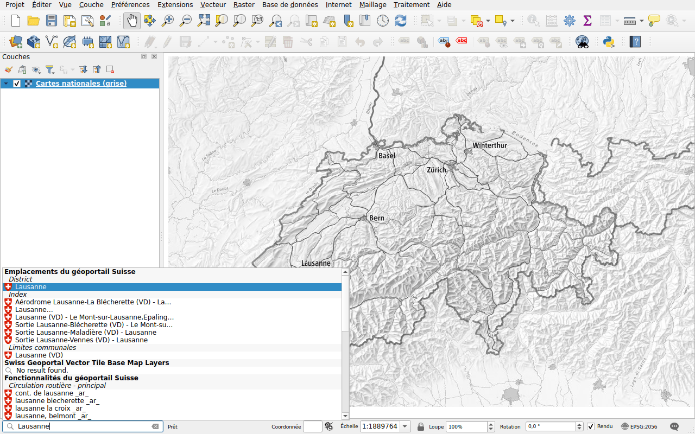
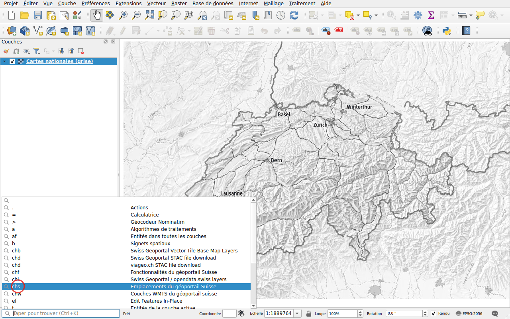

# Prise en main

## Installer

Dans QGIS, ouvrez **Extensions ▸ Installer/Gérer les extensions**, recherchez
*Swiss Locator* et cliquez sur **Installer l'extension**. L'extension nécessite
QGIS 3.44 ou plus récent, QGIS 4 compris.

## Rechercher

La barre de localisation se trouve en bas à gauche de la fenêtre de QGIS.
Cliquez dedans, ou appuyez sur ++ctrl+k++, et tapez au moins deux caractères.
Les résultats arrivent au fur et à mesure que les services répondent, groupés
par type.

Double-cliquez sur un résultat, ou sélectionnez-le avec les flèches et appuyez
sur ++enter++ :

- un lieu ou un objet : la carte s'y déplace et le met en évidence;
- une couche ou un fond de plan : l'extension l'ajoute à la carte;
- un fichier : il est téléchargé, puis ajouté à la carte.

## Restreindre la recherche avec un préfixe

Sans préfixe, toutes les recherches de l'extension sont lancées, ainsi que
celles de QGIS. Commencez par un préfixe et un espace pour n'en lancer qu'une :

| Préfixe | Recherche |
|---------|-----------|
| `chs` | [Lieux](search/locations.md) |
| `chl` | [Couches WMS](layers/wms.md), du géoportail et d'opendata.swiss |
| `chw` | [Couches WMTS](layers/wmts.md) |
| `chb` | [Fonds de plan](layers/base-maps.md), en tuiles vectorielles |
| `chf` | [Objets](search/features.md) |
| `chd` | [Télécharger des données](downloads.md), du géoportail et de viageo.ch |

Par exemple, `chs Lausanne` ne recherche que les lieux nommés Lausanne.

Inutile de les retenir : cliquez dans la barre de localisation sans rien
taper, elle liste toutes les recherches avec leur préfixe. Double-cliquez sur
l'une d'elles : son préfixe est tapé pour vous.

Les préfixes, et les recherches lancées sans préfixe, peuvent être modifiés
dans les [options de QGIS](configuration.md#in-the-options-of-qgis).

## Langue

Les résultats arrivent dans la langue de QGIS quand le géoportail la propose :
anglais, français, allemand, italien ou romanche. Sinon, en anglais. La langue
peut être choisie dans la [configuration](configuration.md) de l'extension.

## Système de coordonnées de référence

La carte peut utiliser n'importe quel système de coordonnées de référence.
L'extension demande les résultats en MN95 (EPSG:2056), ou en MN03 (EPSG:21781)
quand le projet l'utilise, et QGIS les transforme.
