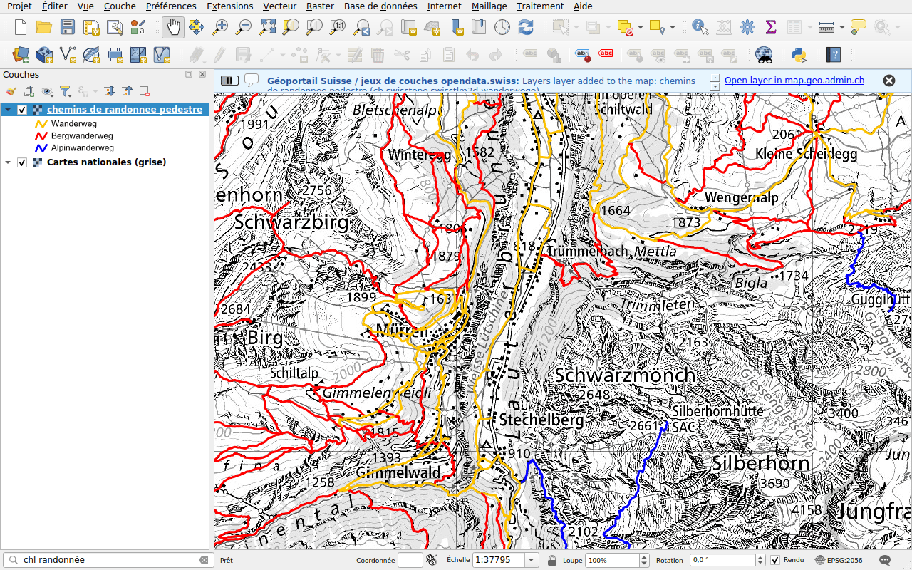

# Swiss Locator

Swiss Locator amène le géoportail fédéral dans QGIS. Tapez dans la barre de
localisation de QGIS, comme sur [map.geo.admin.ch](https://map.geo.admin.ch),
et trouvez :

- des **lieux** : cantons, communes, districts, codes postaux, adresses,
  parcelles et noms de la carte nationale;
- des **couches** du géoportail fédéral et des services cantonaux référencés
  par [opendata.swiss](https://opendata.swiss), en WMS ou en WMTS;
- les **fonds de plan** de swisstopo, en tuiles vectorielles;
- des **objets** des couches du géoportail, comme un arrêt de transports
  publics ou une cabane de montagne;
- des **fichiers à télécharger** des catalogues de données du géoportail et de
  [viageo.ch](https://viageo.ch), pour les cantons et les communes (STAC).

Elle dessine aussi le terrain de swissALTI3D dans les **profils d'élévation**
de QGIS, et [géocode](geocoding.md) des **tables d'adresses** avec les
traitements.

## Pour commencer

1. Dans QGIS, ouvrez **Extensions ▸ Installer/Gérer les extensions**,
   recherchez *Swiss Locator* et installez l'extension. Elle nécessite
   QGIS 3.44 ou plus récent.
2. Cliquez dans la barre de localisation, en bas à gauche de la fenêtre, ou
   appuyez sur ++ctrl+k++.
3. Tapez un lieu, par exemple `Lausanne`, et double-cliquez sur un résultat.

La page [Prise en main](getting-started.md) présente la barre de localisation.
Ensuite, [recherchez des lieux et des objets](search/index.md),
[ajoutez des couches](layers/index.md) ou
[téléchargez des données](downloads.md).

## À propos

L'extension est développée par [OPENGIS.ch](https://opengis.ch) avec le soutien
du [groupe d'utilisateurs suisse de QGIS](https://qgis.ch). Son code est sur
[GitHub](https://github.com/opengisch/qgis-swiss-locator), où vous pouvez
signaler des problèmes.
