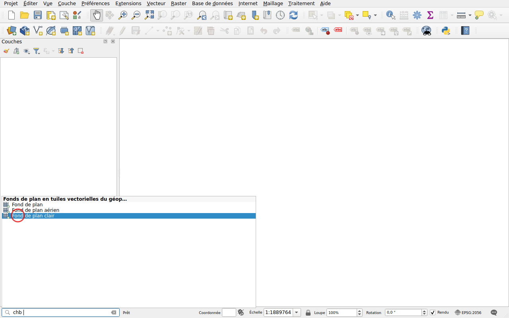
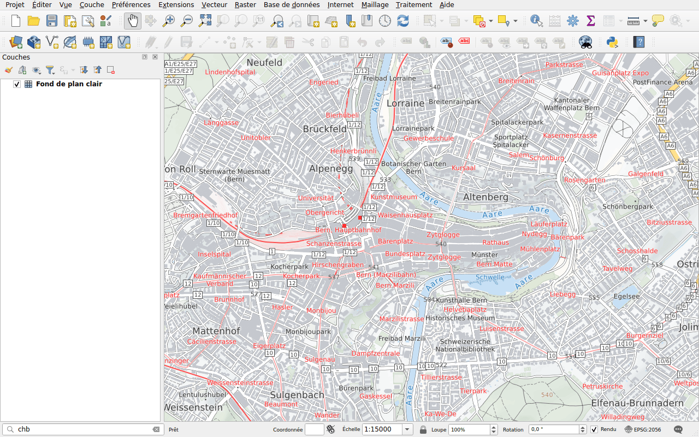

# Fonds de plan

Préfixe : `chb`

Ajoutez un fond de plan de swisstopo, en tuiles vectorielles :

- **Fond de plan**, en couleur;
- **Fond de plan clair**, en gris clair, pour mettre vos données en avant;
- **Fond de plan aérien**, des images aériennes avec les routes et les noms.

Les tuiles vectorielles restent nettes à toutes les échelles.

Ajouté à un projet vide, un fond de plan met le projet en MN95 (EPSG:2056),
plutôt qu'en Web Mercator, le SCR des tuiles. Quand **Utiliser le SCR par
défaut** est choisi dans **Préférences ▸ Options ▸ SCR et Transformations ▸
Gestion des SCR**, le projet garde ce SCR.

## Exemple

Tapez `chb` suivi d'un espace : les trois fonds de plan sont listés.

Double-cliquez sur **Fond de plan clair**. Il est ajouté en bas de la liste
des couches, sous vos données.

