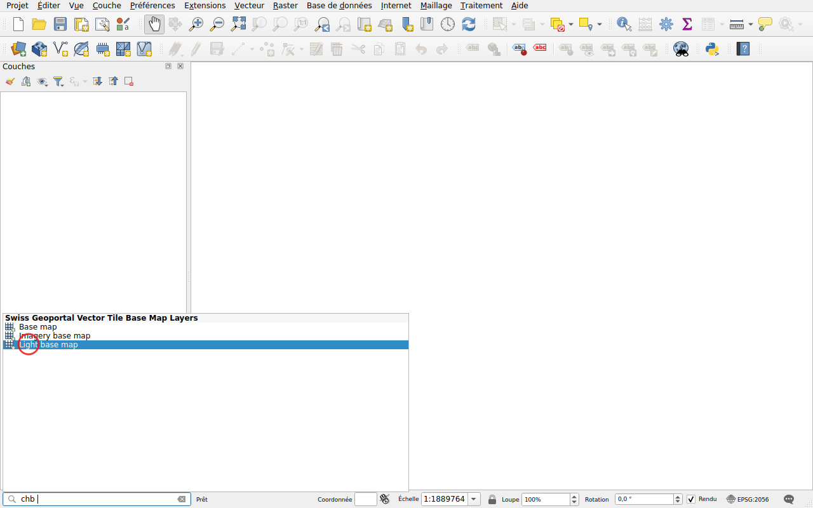
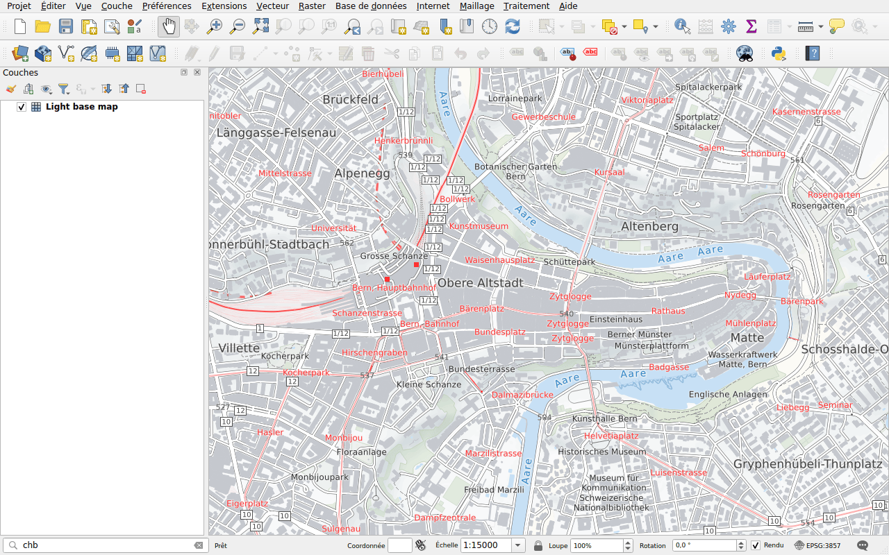

# Fonds de plan

Préfixe : `chb`

Ajoutez un fond de plan de swisstopo, en tuiles vectorielles :

- **Base map**, en couleur;
- **Light base map**, en gris clair, pour mettre vos données en avant;
- **Imagery base map**, des images aériennes avec les routes et les noms.

Les tuiles vectorielles restent nettes à toutes les échelles.

## Exemple

Tapez `chb` suivi d'un espace : les trois fonds de plan sont listés.

Double-cliquez sur **Light base map**. Il est ajouté en bas de la liste des
couches, sous vos données.

