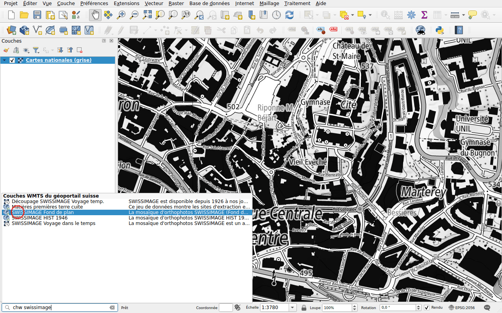
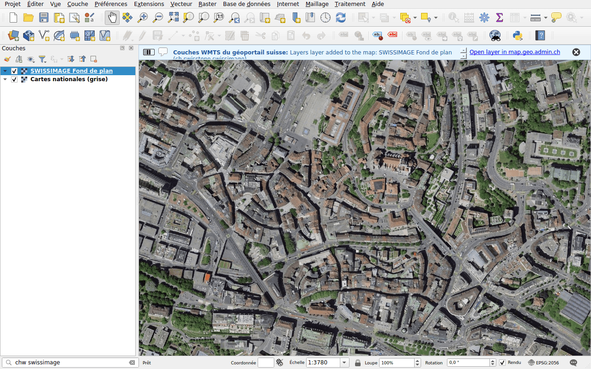

# Couches WMTS

Préfixe : `chw`

Trouvez une couche du service WMTS du géoportail, wmts.geo.admin.ch, et
ajoutez-la à la carte. Tuilées, ces couches s'affichent plus vite que les
couches WMS. La recherche porte sur l'identifiant, le titre et la description
de chaque couche.

## Exemple : images aériennes

Tapez `chw swissimage`.

Double-cliquez sur **SWISSIMAGE Fond de plan**, les images aériennes de
swisstopo.

## Couches temporelles

Les couches à plusieurs dates, comme *Voyage dans le temps*, ont une icône
d'horloge. QGIS les ajoute comme couches temporelles : choisissez la date dans
le panneau **Vue ▸ Panneaux ▸ Contrôleur temporel**.

!!! note
    Certaines couches du géoportail ne peuvent être affichées que sur
    map.geo.admin.ch. Quand une couche ne peut pas être ajoutée, un message
    l'indique.
