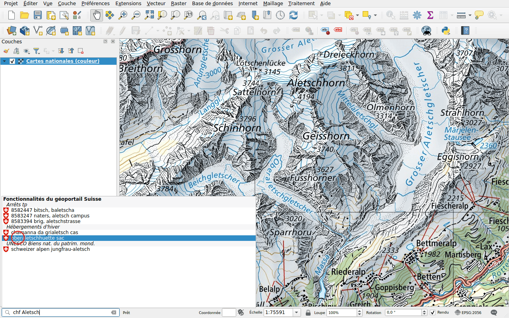
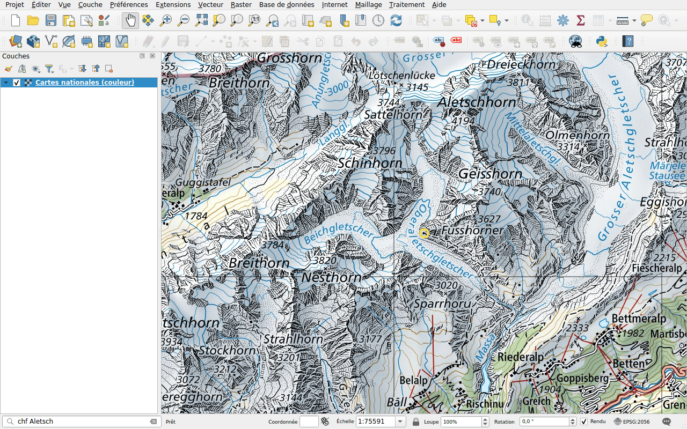

# Objets

Préfixe : `chf`

Trouvez un objet dans les couches du géoportail : un arrêt de transports
publics, une cabane de montagne, un site des inventaires fédéraux, un point
fixe… La recherche nécessite au moins quatre caractères.

## Exemple

Tapez `chf Aletsch`. Les résultats sont groupés par couche : un arrêt de
transports publics, le site du patrimoine mondial de l'UNESCO, des cabanes de
montagne.

Double-cliquez sur **oberaletschhuette sac**. La carte se centre sur la cabane
et l'entoure d'un cercle.

## Choisir les couches à rechercher

La recherche porte sur les couches du géoportail dont les objets peuvent être
recherchés, soit quelques centaines. Pour n'en rechercher que certaines, comme
les arrêts des transports publics, sélectionnez-les dans l'onglet
**Recherche d'objets** de la [configuration](../configuration.md#feature-search).
L'exemple ci-dessus recherche dans quatre couches : les arrêts des transports
publics, les sites du patrimoine mondial de l'UNESCO, les hébergements d'hiver
et les géotopes.
