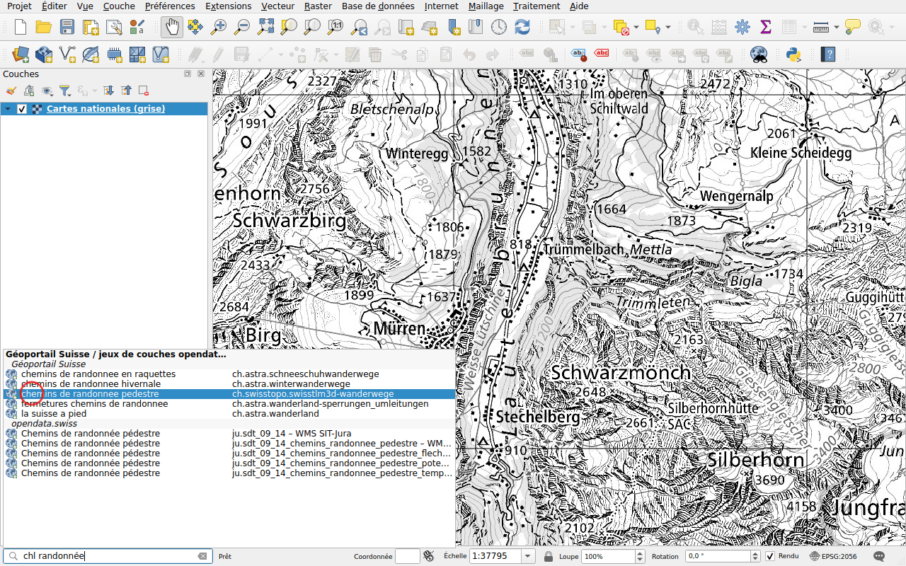
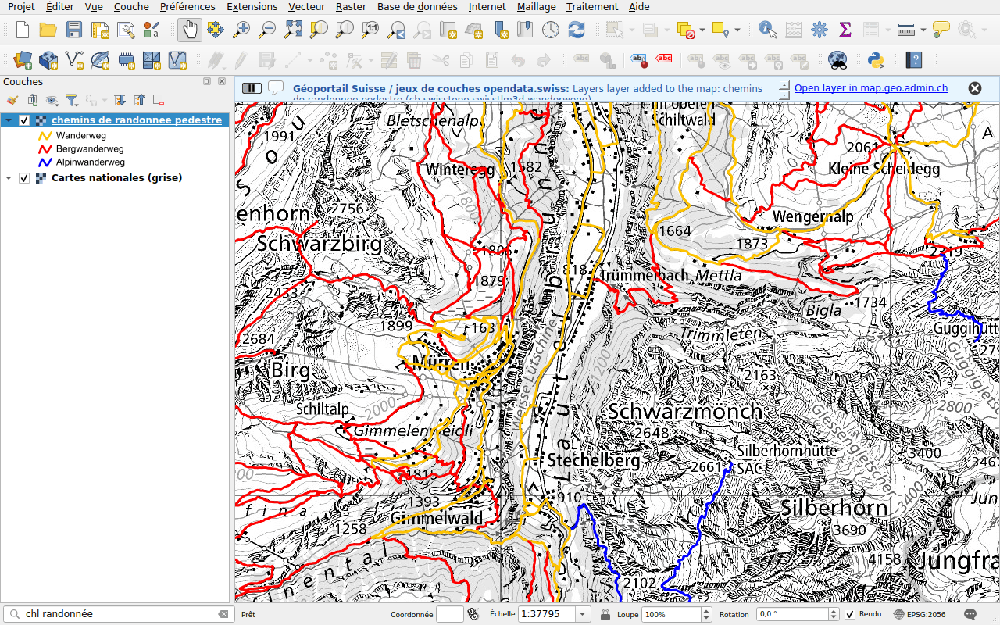
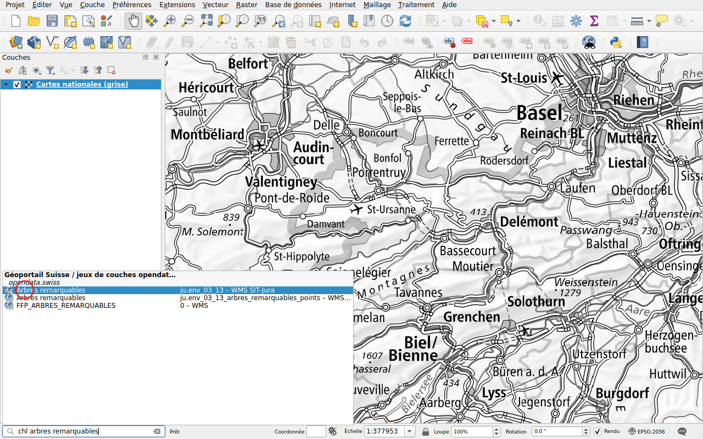
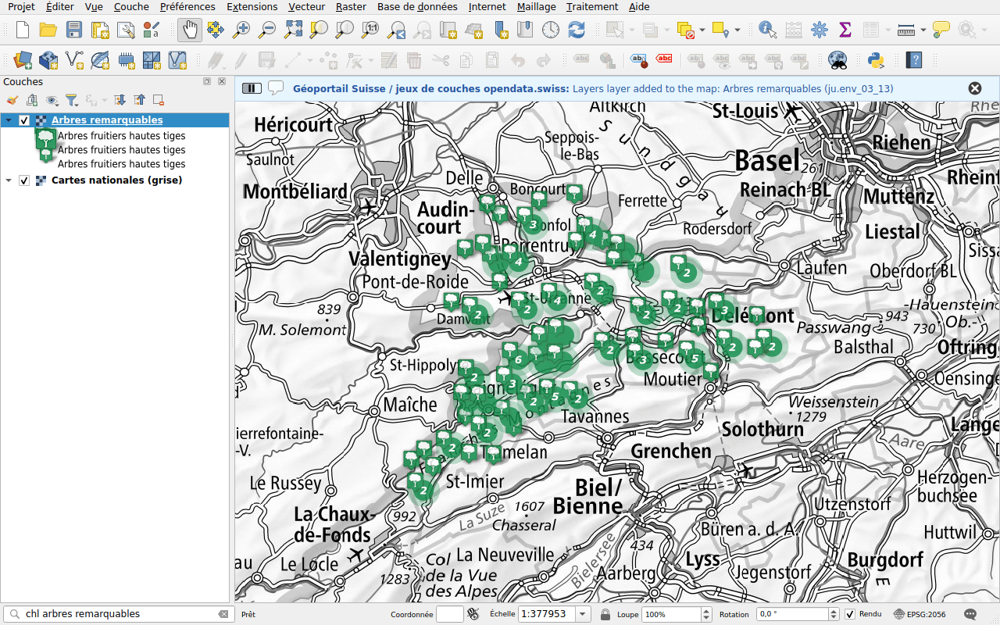

# Couches

Préfixe : `chl`

Trouvez une couche par son nom ou son titre, et ajoutez-la à la carte en WMS.
La recherche couvre :

- les couches du géoportail fédéral, map.geo.admin.ch;
- les couches des services WMS des cantons, des villes et d'autres
  organisations, référencés par [opendata.swiss](https://opendata.swiss).

## Exemple : une couche du géoportail

Tapez `chl randonnée`. Les couches du géoportail sont listées avec leur
identifiant, avec aussi des couches d'opendata.swiss.

Double-cliquez sur **chemins de randonnee pedestre**. La couche est ajoutée à
la carte, avec sa légende. Un message propose d'ouvrir la couche sur
map.geo.admin.ch.

## Exemple : une couche d'un service cantonal

Les cantons et les villes publient leurs propres services WMS, référencés par
opendata.swiss. Leurs couches se trouvent par leur titre, mais aussi par leur
nom, comme `ch.gl.transportation.wanderwege`. Les résultats apparaissent sous
**opendata.swiss**, avec le nom de la couche et le titre de son service.

Tapez `chl arbres remarquables`. Les résultats sont des couches
*Arbres remarquables* du service *WMS SIT-Jura*, du canton du Jura.

Double-cliquez sur l'une d'elles : les arbres remarquables du canton du Jura
sont sur la carte.

!!! note
    Les couches des services référencés par opendata.swiss sont listées dans un
    fichier publié avec cette documentation, que QGIS télécharge au plus une
    fois par jour, voir [Sources des données](../data-sources.md). Une couche
    ajoutée à un service apparaît après la prochaine mise à jour de la liste.

La recherche dans opendata.swiss peut être désactivée dans la
[configuration](../configuration.md).
