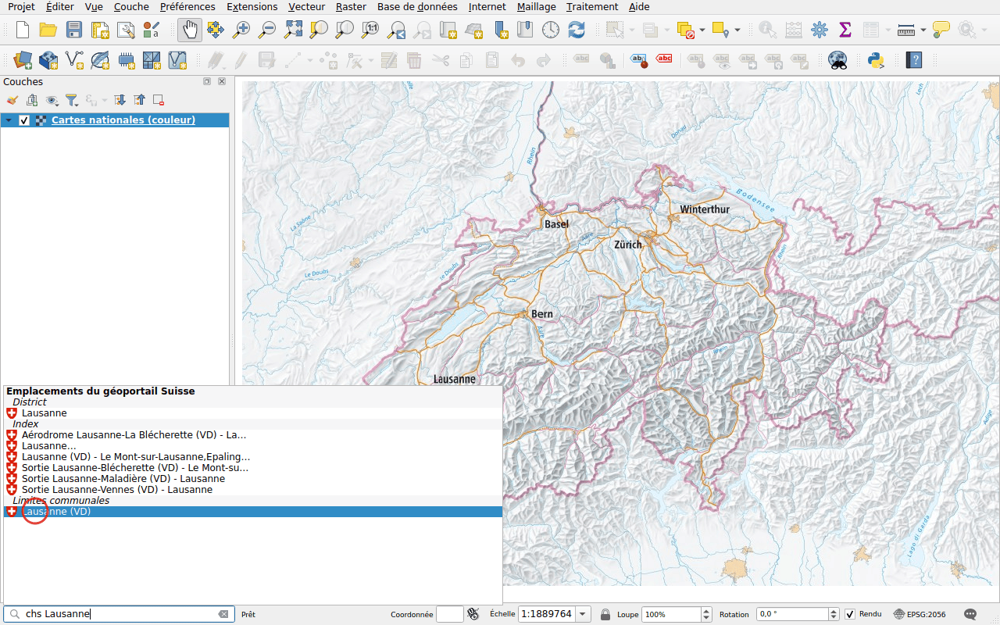
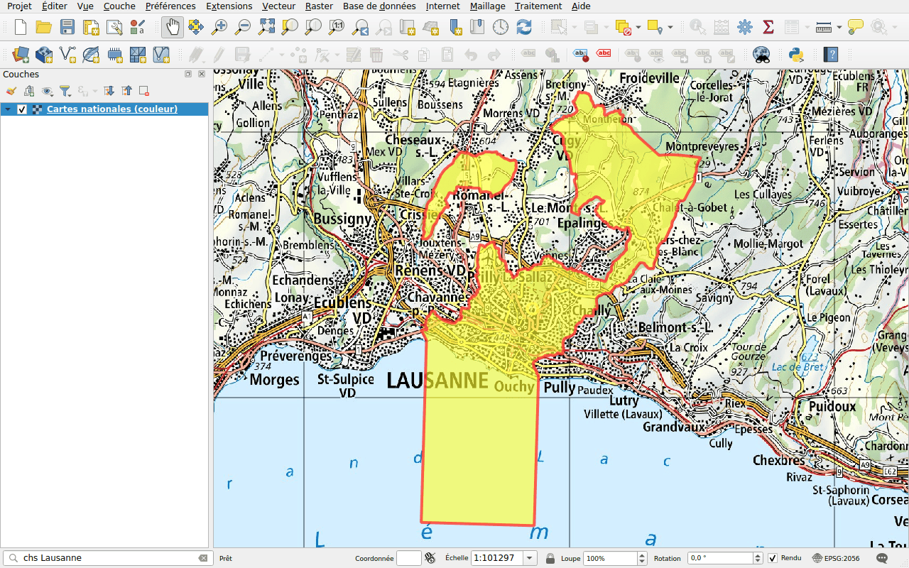
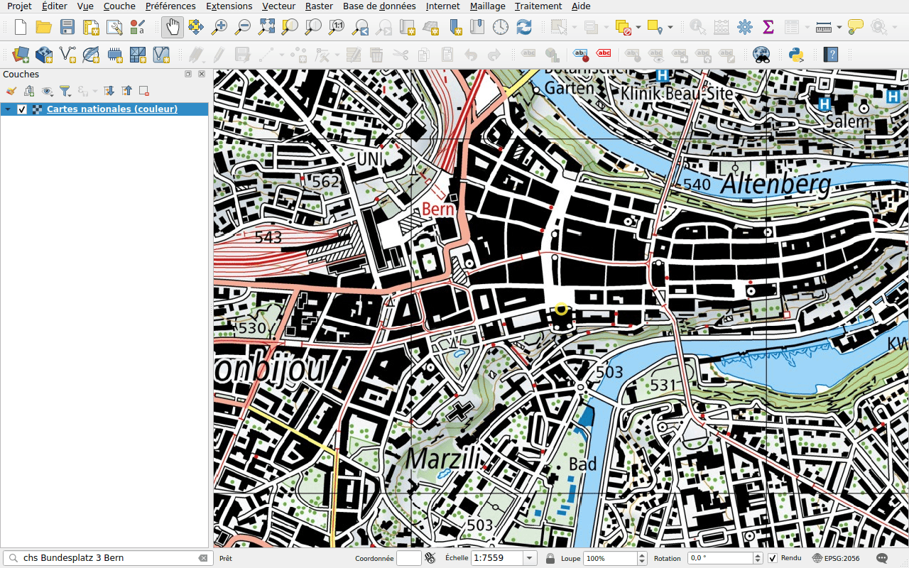

# Lieux

Préfixe : `chs`

Trouvez un lieu comme sur map.geo.admin.ch :

- cantons, districts et communes;
- codes postaux;
- adresses;
- parcelles;
- noms de la carte nationale (swissNAMES3D), comme un sommet, un lac ou une
  sortie d'autoroute.

## Exemple : une commune

Tapez `chs Lausanne`. Les résultats sont groupés par type : le district, les
noms de la carte nationale, la commune.

Double-cliquez sur **Lausanne (VD)** sous **Limites communales**. La carte
zoome sur la commune et dessine sa limite.

## Exemple : une adresse

Tapez `chs Bundesplatz 3 Bern` et choisissez l'adresse. La carte se centre sur
le bâtiment et l'entoure d'un cercle.

!!! tip
    Pour un point, comme une adresse, la carte garde son échelle. Zoomez
    d'abord, ou utilisez ensuite les outils de zoom.

La mise en évidence d'un lieu dont la limite n'est pas dessinée, comme une
parcelle, disparaît après quelques secondes.
