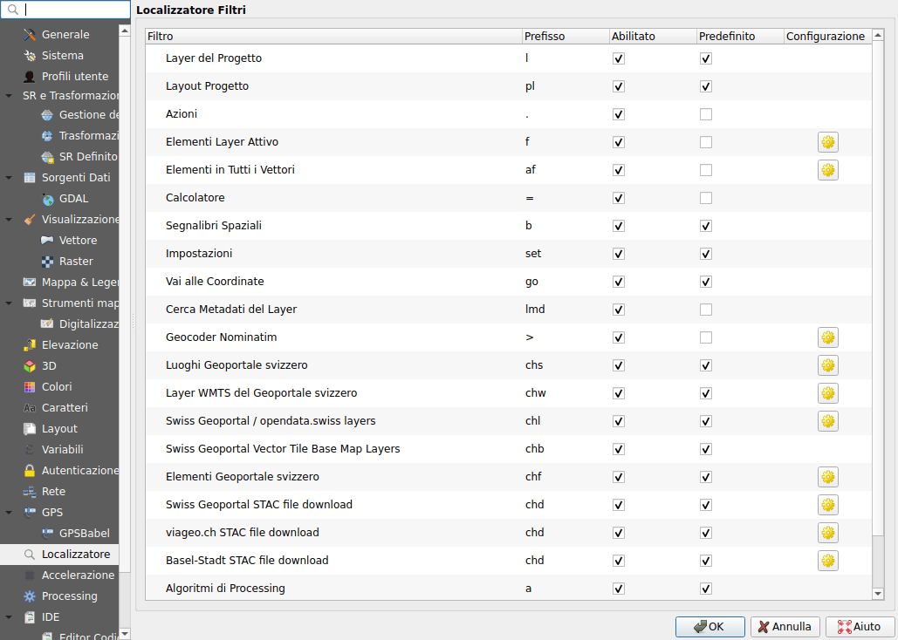
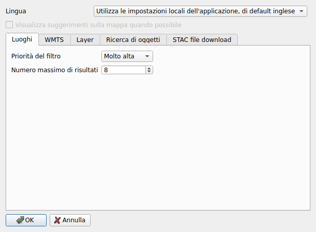
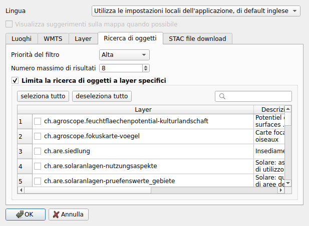

# Configurazione

## Nelle opzioni di QGIS {#in-the-options-of-qgis}

Aprire **Impostazioni ▸ Opzioni ▸ Localizzatore**. Ogni ricerca del plugin è
elencata con il suo prefisso:

- **Abilitato**: deselezionarlo per disattivare la ricerca;
- **Predefinito**: se selezionato, la ricerca viene eseguita senza prefisso;
- **Prefisso**: può essere modificato;
- il pulsante a destra apre la configurazione del plugin (le mappe di base non
  ne hanno).

Il download di dati ha una ricerca per catalogo, con lo stesso prefisso:
**Swiss Geoportal STAC file download**,
**viageo.ch STAC file download** e **Basel-Stadt STAC file download**.

## Nel plugin

La configurazione del plugin si apre dal pulsante di una ricerca nelle opzioni
descritte sopra.

**Lingua**
:   La lingua dei risultati. Per impostazione predefinita, quella di QGIS se il
    geoportale è disponibile in questa lingua, altrimenti l'inglese.

**Visualizza suggerimenti sulla mappa quando possibile**
:   Mostra le informazioni di map.geo.admin.ch su un luogo o un oggetto, in un
    fumetto sopra la mappa. Richiede la libreria QtWebKit, che QGIS 4 non ha:
    in tal caso l'opzione è disattivata.

Ogni ricerca, tranne le mappe di base, ha la sua scheda:

**Priorità del filtro**
:   L'ordine dei risultati delle ricerche nella barra di localizzazione.

**Numero massimo di risultati**
:   Quanti risultati elenca la ricerca.

**Includi i dati di opendata.swiss** (layer WMS)
:   Cerca anche i layer dei servizi referenziati da opendata.swiss.

**Maximum number of files per result** (download di dati)
:   Un set di dati con un numero maggiore di file apre il pannello di filtro
    invece di elencarli.

| Ricerca | Priorità | Risultati |
|---------|----------|-----------|
| Località | molto alta | 8 |
| Layer WMS | alta | 5 |
| Layer WMTS | media | 8 |
| Oggetti | alta | 8 |
| Scaricare dati | bassa | 5 per catalogo, e 5 file per risultato |

### Ricerca di oggetti {#feature-search}

Per impostazione predefinita, la ricerca di oggetti copre tutti i layer del
geoportale con oggetti ricercabili. Selezionare
**Limita la ricerca di oggetti a layer specifici** e scegliere i layer da
cercare: la casella di ricerca filtra l'elenco.

