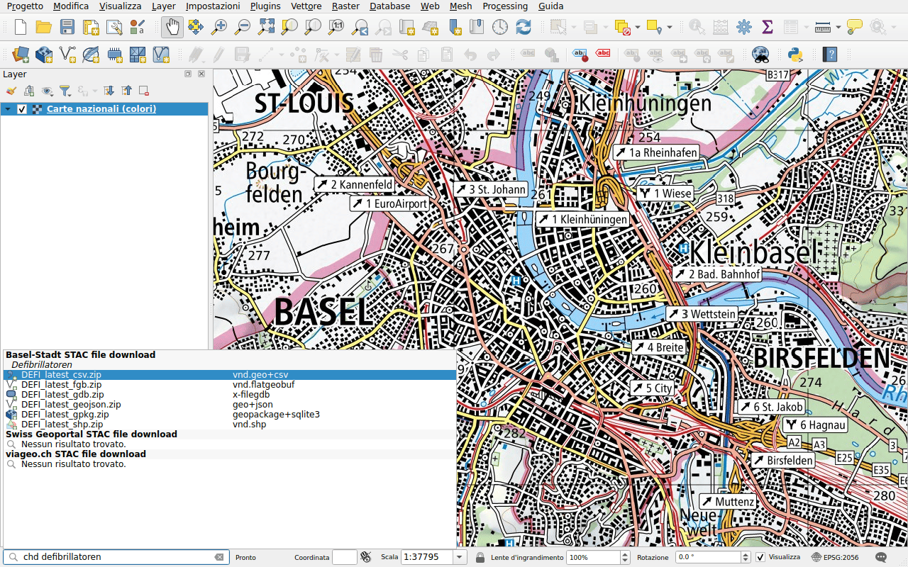

# Dati di Basilea Città

Prefisso: `chd`

Il Cantone di Basilea Città pubblica i suoi geodati su
[geo.bs.ch](https://www.geo.bs.ch): piani delle zone, misurazione ufficiale,
percorsi ciclabili, defibrillatori e altro ancora. Ogni set di dati è
disponibile in più formati, tutti elencati: GeoPackage, GeoJSON, FlatGeobuf,
Shapefile, FileGDB, CSV e per alcuni DXF e DWG. I suoi titoli sono in tedesco:
digitare `chd defibrillatoren`.

Fare doppio clic su un formato e scegliere una cartella: il file, un archivio
(ZIP), viene scaricato e il set di dati che contiene viene aggiunto alla mappa.
QGIS non sempre legge i file DWG e INTERLIS: l'archivio viene allora solo
scaricato.
