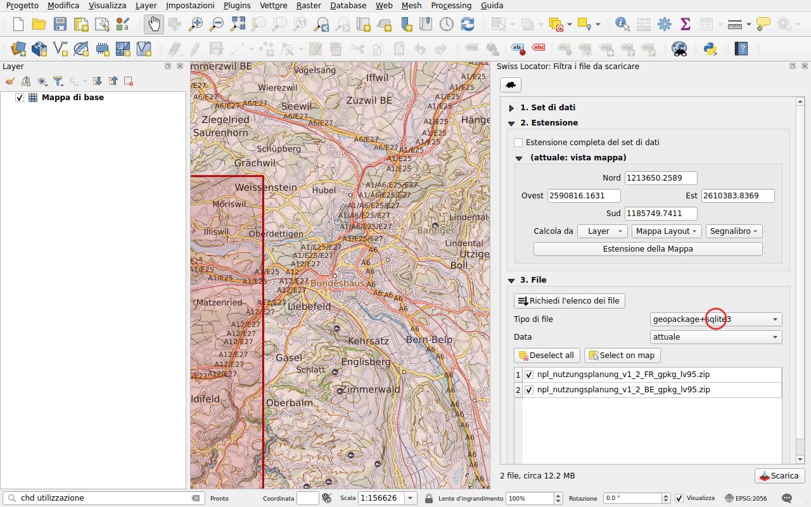

# Dati dei cantoni (geodienste.ch)

Prefisso: `chd`

[geodienste.ch](https://geodienste.ch) pubblica i geodati dei cantoni nei
modelli di dati della Confederazione, gli stessi per ogni cantone: misurazione
ufficiale, piani di utilizzazione, carte dei pericoli, piani direttori, catasto
dei siti inquinati, zone di tranquillità per la fauna selvatica e una trentina
di altri. I suoi titoli sono in tedesco, francese o italiano, nella lingua del
plugin, altrimenti in tedesco: digitare `chd utilizzazione`.

La sua ricerca viene eseguita per impostazione predefinita: deselezionarlo tra
i [cataloghi locali](../configuration.md#in-the-plugin) per escluderlo.

Un set di dati ha un file per cantone e per formato: il suo risultato apre il
[pannello di filtro](swisstopo.md#a-dataset-with-many-files), che elenca i
cantoni dell'estensione. Il contorno di un file è il rettangolo attorno al suo
cantone. Non tutti i cantoni pubblicano tutti i set di dati, e alcuni forniscono
i loro solo con un login su geodienste.ch, come la misurazione ufficiale di
Lucerna o di Vaud: il loro download non riesce.

Scegliere il formato sotto **Tipo di file**:

- GeoPackage, Shapefile e CSV: l'archivio (ZIP) viene scaricato e i set di dati
  che contiene vengono aggiunti alla mappa; un CSV è una tabella, senza
  geometria. Le loro tabelle e i loro attributi sono nominati nella lingua del
  catalogo.
- INTERLIS: l'archivio contiene il trasferimento e il suo modello, e viene solo
  scaricato; aprirlo con un plugin come
  [Model Baker](https://opengisch.github.io/QgisModelBaker/). Anche i file di
  trasferimento sono elencati, uno per comune per la misurazione ufficiale.

La misurazione ufficiale di un grande cantone pesa centinaia di megabyte, oltre
un gigabyte in INTERLIS: per un comune, prendere il suo file di trasferimento.
